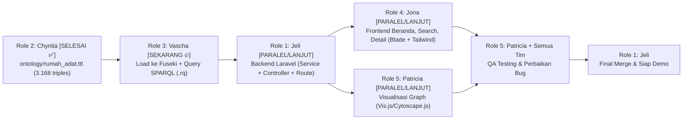

# Panduan Urutan Pengerjaan Project — Search Engine Rumah Adat Sumatera Utara

> **Terakhir Diperbarui:** 23 November 2026 (Commit `1f8bc44`)

Dokumen ini menjadi **panduan langkah demi langkah** untuk **Kelompok 07** agar semua anggota tahu:
1. **Tahap mana yang sudah selesai** dan mana yang sedang berjalan sekarang,
2. **Siapa mengerjakan apa** sesuai pembagian peran,
3. **Kontrak nama Class & Property asli** dari `ontology/rumah_adat.ttl` yang dipakai bersama oleh Query SPARQL, Backend Laravel, Frontend, dan Knowledge Graph.

---

## 1. Pembagian Peran Tim (Kelompok 07)

| Role | Nama | Fokus Utama | Output Utama |
| :--- | :--- | :--- | :--- |
| **Role 1** | **Jeli** | Project Lead & Backend Integration | Kerangka Laravel, Service penghubung Fuseki, Controller, code review & merge branch, kestabilan saat demo |
| **Role 2** | **Chyntia** | Ontology & RDF Dataset Engineer | Dokumen data bersih, skema ontologi (Protégé/Turtle), file `ontology/rumah_adat.ttl` valid tanpa error |
| **Role 3** | **Vascha** | SPARQL Query & Semantic Logic Developer | Setup Apache Jena Fuseki, file query `.rq` (multi-hop, filter, detail, alasan keterkaitan / *match path*) |
| **Role 4** | **Jona** | UI/UX Designer & Frontend Utama | Tampilan responsif Beranda, Hasil Pencarian (+ badge alasan keterkaitan), & Halaman Detail (+ panel relasi semantik) |
| **Role 5** | **Patricia Putri** | Knowledge Graph Visualization & QA Tester | Halaman Visualisasi Knowledge Graph interaktif (`Vis.js` / `Cytoscape.js`) & hasil pengujian (QA Checklist) bebas bug |

---

## 2. Cara Kerja Aplikasi Kita (Versi Sederhana)

Bayangkan aplikasi kita seperti **restoran**:

1. **Chyntia (Bahan Makanan & Resep — `SELESAI ✅`):** Sudah menyiapkan seluruh pengetahuan terhubung di `ontology/rumah_adat.ttl` (42 rumah adat beserta suku, marga, bahasa, wilayah bertingkat, ornamen, tradisi, hingga hubungan kekerabatan antar-marga dan antar-suku).
2. **Vascha (Dapur & Racikan Pencarian — `TAHAP SEKARANG 🔥`):** Memasukkan `ontology/rumah_adat.ttl` ke server **Apache Jena Fuseki**, lalu menyiapkan perintah pencarian cerdas (**query SPARQL `.rq`**) supaya kalau user mengetik kata yang *tidak langsung* menyebut nama rumah adat (misalnya ketik marga, tradisi seperti `"Maena"`, ornamen, atau nama kabupaten), sistem tetap bisa melacak sampai ke rumah adatnya dan menjelaskan *alasan keterkaitannya*.
3. **Jeli (Pelayan / Penghubung):** Menyiapkan **Laravel** sebagai jembatan. Saat user mencari di website, Laravel mengambil kata kunci user, memanggil query dari Vascha ke server Fuseki, lalu membungkus hasilnya menjadi data rapi.
4. **Jona (Ruang Makan & Menu):** Membuat tampilan website yang cantik dan nyaman dipakai (**Beranda, Hasil Pencarian, Detail**) supaya data dari Jeli tampil lengkap dengan statistik asli dan badge alasan keterkaitan.
5. **Patricia Putri (Peta Interaktif & Quality Control):** Membuat **peta garis hubungan (Knowledge Graph)** pakai `Vis.js` atau `Cytoscape.js` supaya user bisa melihat jaring-jaring budaya secara visual, sekaligus mengetes semua fitur agar bebas bug saat demo.

### Alur Kerja & Ketergantungan Antar Anggota



> **Catatan agar cepat selesai:**  
> Sambil **Vascha** merampungkan `.rq` di Fuseki, **Jeli, Jona, dan Patricia** bisa langsung ngoding paralel sekarang karena seluruh nama Class dan Property di `ontology/rumah_adat.ttl` sudah final!

---

## 3. Posisi Kita Sekarang

- **Sudah selesai (`✅`):**
  - Struktur repo GitHub dan proyek **Laravel 13 + Tailwind CSS v4 + Vite** (**Jeli**).
  - Layout utama (`resources/views/layouts/app.blade.php`) dan tampilan awal **Beranda** (`resources/views/pages/home.blade.php`) beserta *hero search bar* (`GET /search?q=...`) (**Jona**).
  - **Ontologi & dataset RDF lengkap `ontology/rumah_adat.ttl`** (`3.168 triples`, valid 0 error via `dataset/cek_ttl.py`) (**Chyntia & tim**).
- **Yang harus dikerjakan mulai sekarang (`⏳`):**
  - Setup Apache Jena Fuseki + pembuatan file query `.rq` (**Vascha**).
  - Route `/search`, `/rumah-adat/{slug}`, `/graph`, `/api/graph`, `SparqlService`, dan Controller (**Jeli**).
  - Statistik dataset & *quick explore* wilayah di Beranda, Halaman Hasil Pencarian, Halaman Detail, plus foto lokal rumah adat (**Jona**).
  - Halaman Visualisasi Knowledge Graph (`Vis.js` / `Cytoscape.js`) & QA Testing (**Patricia**).

---

## 4. Urutan Pengerjaan Dari Awal Sampai Akhir

---

### FASE 0 — Persiapan Awal & Fondasi Proyek `[STATUS: SUDAH SELESAI ✅]`
*Pelaksana utama: **Jeli** & **Jona***

1. **Jeli** sudah menyiapkan repository GitHub dan proyek Laravel di `tubes_rumah_adat/`.
2. **Jona** sudah membuat tampilan pembuka Beranda (`resources/views/pages/home.blade.php`) dan kerangka layout (`resources/views/layouts/app.blade.php`).

---

### FASE 1 — Kontrak Data & Skema Ontologi Final `[STATUS: SUDAH SELESAI ✅]`
*Acuan wajib bagi **Vascha, Jeli, Jona, & Patricia** saat membuat query dan tampilan!*

Berikut skema **resmi dan final** di `ontology/rumah_adat.ttl` (`@prefix ra: <http://example.org/ontology/rumah-adat#> .`):

1. **7 Kelas Utama (`owl:Class`) & Jumlah Data:**
   - `ra:RumahAdat` (**42** data — meliputi seluruh wilayah Sumut termasuk Nias, Melayu Deli/Langkat/Binjai/Batu Bara/Serdang Bedagai/Asahan/Tanjungbalai/Tebing Tinggi/Labuhanbatu, Karo, Pakpak, Mandailing/Angkola/Pasisi, Toba, dan Simalungun)
   - `ra:Suku` (**15** data)
   - `ra:Marga` (**107** data)
   - `ra:BahasaDaerah` (**13** data)
   - `ra:Wilayah` (**61** data — Provinsi Sumatera Utara + Kabupaten/Kota + Desa/Kecamatan)
   - `ra:Tradisi` (**17** data — termasuk `Maena`, `Owasa`, `Hombo Batu`, `Merdang Merdem`, `Merkottas`, `Jamu Laut`, `Rondang Bintang`, `Manortor`, `Tepung Tawar`, dll.)
   - `ra:Ornamen` (**13** data)
2. **11 Object Properties (Penghubung Antar-Entitas):**
   - `ra:berasalDariWilayah` (`RumahAdat` / `Marga` → `ra:Wilayah`)
   - `ra:bagianDariWilayah` (**`owl:TransitiveProperty`**, `ra:Wilayah` → `ra:Wilayah`)
   - `ra:dimilikiOlehSuku` (`ra:RumahAdat` → `ra:Suku`)
   - `ra:memilikiMarga` (`ra:RumahAdat` → `ra:Marga`)
   - `ra:menggunakanBahasa` (`ra:RumahAdat` → `ra:BahasaDaerah`)
   - `ra:memilikiOrnamen` (`ra:RumahAdat` → `ra:Ornamen`)
   - `ra:memilikiTradisi` (`ra:RumahAdat` → `ra:Tradisi`)
   - `ra:menuturkanBahasa` (`ra:Suku` → `ra:BahasaDaerah`)
   - `ra:bagianDariSuku` (`ra:Marga` → `ra:Suku`)
   - `ra:berkerabatDenganMarga` (**`owl:SymmetricProperty`**, `ra:Marga` → `ra:Marga`)
   - `ra:berkerabatDenganSuku` (**`owl:SymmetricProperty`**, `ra:Suku` → `ra:Suku`)
3. **9 Datatype Properties (`ra:RumahAdat` & Label Umum):**
   - Semua individu di 7 kelas memiliki **`ra:nama`** sekaligus **`rdfs:label`** (100% seragam!).
   - Setiap `ra:RumahAdat` memiliki lengkap: `ra:nama`, `rdfs:label`, `ra:namaAlternatif`, `ra:sejarah`, `ra:fungsi`, `ra:ciriArsitektur`, `ra:bentukAtap`, `ra:bahanBangunan`, `ra:maknaFilosofis`, dan `ra:referensi`.
   - *(Catatan penting: properti `ra:linkFoto` sudah dihapus dari `.ttl`, jadi gambar kartu rumah adat disiapkan memakai file lokal di `public/images/rumah-adat/` yang dipetakan di Laravel berdasarkan slug/ID rumah adat).*

---

### FASE 2 — Pengolahan Data & Validasi `ontology/rumah_adat.ttl` `[STATUS: SUDAH SELESAI ✅]`
*Pelaksana utama: **Chyntia** & tim*

1. File `ontology/rumah_adat.ttl` sudah dibangun, dibersihkan, dan disempurnakan hingga **3.168 triples** (`0` syntax error, `0` pelanggaran domain/range, `0` wilayah daun menganggur).
2. Skrip pengecek `dataset/cek_ttl.py` sudah tersedia dan lulus 100% saat dijalankan dengan `python dataset/cek_ttl.py`.
3. **Catatan file kembar:** Gunakan selalu **`ontology/rumah_adat.ttl`** sebagai sumber resmi (`3.168 triples`), **bukan** file `dataset/rumah_adat.ttl` (`2.739 triples`, salinan versi lama yang sebaiknya dihapus agar tidak membingungkan).

---

### FASE 3 — Setup Apache Jena Fuseki & Membuat Query SPARQL (`.rq`) `[STATUS: PRIORITAS SEKARANG 🔥]`
*Pelaksana utama: **Vascha** (memakai `ontology/rumah_adat.ttl`)*

#### Yang Dikerjakan Vascha (Urutan Langkah):
1. **Load Dataset ke Apache Jena Fuseki:**
   - Jalankan server Fuseki (`http://localhost:3030`) dan buat dataset baru (misalnya bernama `rumah_adat`).
   - Upload file **`ontology/rumah_adat.ttl`** ke dataset tersebut dan pastikan jumlah triple terbaca **3.168 triples**.
2. **Tulis & Uji Query SPARQL Satu Per Satu di Fuseki UI:**
   Simpan setiap query yang sudah berhasil menjadi file `.rq` di folder `tubes_rumah_adat/resources/sparql/`:
   - **`01_statistik.rq`:** Menghitung total `ra:RumahAdat` (42), `ra:Suku` (15), `ra:Marga` (107), `ra:Wilayah` (61), `ra:Tradisi` (17), dan `ra:Ornamen` (13).
   - **`02_search_multihop.rq`:** Pencarian kata kunci bebas (`?keyword`) yang bisa menelusuri **lintas hubungan (multi-hop)**:
     - Cocok langsung di `ra:nama` / `ra:namaAlternatif` / `ra:ciriArsitektur` / `ra:sejarah` rumah adat.
     - Cocok lewat **Wilayah bertingkat** memakai *property path* `ra:berasalDariWilayah/ra:bagianDariWilayah*` (misal user cari `"Kabupaten Toba"` → menemukan rumah adat di Balige & Jangga Dolok!).
     - Cocok lewat **Suku & Kerabat Suku** (`ra:dimilikiOlehSuku/ra:berkerabatDenganSuku?`).
     - Cocok lewat **Marga & Kerabat Marga** (`ra:memilikiMarga/ra:berkerabatDenganMarga?` dan `ra:bagianDariSuku`).
     - Cocok lewat **Bahasa Daerah** (`ra:menggunakanBahasa` atau `ra:dimilikiOlehSuku/ra:menuturkanBahasa`).
     - Cocok lewat **Tradisi** (misal cari `"Maena"` → menemukan 4 Rumah Adat Nias!) dan **Ornamen** (misal cari `"Gorga"` → menemukan Rumah Bolon Toba).
   - **`03_match_path.rq` (atau kolom `?alasan` di query search):** Mengembalikan **alasan keterkaitan**, contoh:
     - User mencari: `"Maena"` → Hasil: **Omo Hada & Omo Sebua** → Alasan: `Terhubung melalui Tradisi: Maena`
     - User mencari: `"Kabupaten Karo"` → Hasil: **Rumah Siwaluh Jabu Desa Lingga** → Alasan: `Terhubung melalui Wilayah: Desa Lingga → Kabupaten Karo`
     - User mencari: `"Harahap"` → Hasil: **Bagas Godang Angkola** → Alasan: `Terhubung melalui Marga: Harahap`
   - **`04_filter.rq`:** Query pencarian + filter kategori (misal filter berdasarkan wilayah kabupaten/kota, suku, ornamen, atau tradisi).
   - **`05_detail.rq`:** Mengambil seluruh atribut lengkap 1 rumah adat berdasarkan URI/ID beserta daftar suku, marga, wilayah induk, bahasa, ornamen, tradisi, dan rumah adat kerabatnya.
   - **`06_knowledge_graph.rq`:** Mengambil triplet relasi (`?source`, `?sourceLabel`, `?sourceType`, `?predicate`, `?target`, `?targetLabel`, `?targetType`) untuk visualisasi graf interaktif Patricia (bisa untuk keseluruhan graf atau fokus 1 rumah adat tertentu).
3. **Dokumentasikan Parameter Query:**
   - Catat placeholder yang perlu diganti oleh Laravel (misal `__KEYWORD__`, `__WILAYAH__`, `__SUKU__`, `__RUMAH_URI__`) agar Jeli mudah memanggilnya.

> **Selesai jika:** Semua file `.rq` sudah diuji langsung di Apache Jena Fuseki, mengembalikan hasil akurat tanpa duplikasi baris yang mengganggu, dan sudah di-push ke branch Vascha.

---

### FASE 4 — Menghubungkan Laravel dengan Fuseki (Integrasi Backend) `[STATUS: SIAP DIKERJAKAN PARALEL]`
*Pelaksana utama: **Jeli***

#### Yang Dikerjakan Jeli (Urutan Langkah):
1. **Konfigurasi Koneksi Triplestore:**
   - Tambahkan variabel `FUSEKI_URL=http://localhost:3030` dan `FUSEKI_DATASET=rumah_adat` di `.env` dan `.env.example`, lalu daftarkan di `config/services.php`.
2. **Bangun `SparqlService` / `RumahAdatSearchService`:**
   - Buat class di `app/Services/` untuk:
     - Membaca file `.rq` dari `resources/sparql/`.
     - Menyisipkan kata kunci/filter user secara aman (**sanitasi input** agar karakter seperti `"`, `\`, `{`, `}` tidak merusak query SPARQL).
     - Mengirim request ke endpoint SPARQL Fuseki menggunakan `Http::asForm()->post(...)` dengan header `Accept: application/sparql-results+json`.
     - Mengelompokkan hasil JSON Fuseki menjadi array PHP yang rapi (menggabungkan multiple marga/tradisi/alasan keterkaitan agar 1 rumah adat tidak muncul berulang kali sebagai kartu kembar).
     - Menambahkan mapping path foto lokal (berdasarkan ID rumah adat → file gambar di `public/images/rumah-adat/`, dengan fallback ke gambar default jika foto khusus belum ada).
3. **Pasang ke Controller & Route (`routes/web.php`):**
   - `HomeController` → mengambil statistik asli (`42 Rumah Adat`, `15 Suku`, `61 Wilayah`, `107 Marga`) dan daftar wilayah populer untuk `home.blade.php`.
   - `SearchController` → melayani `GET /search` (input `q`, filter kategori, hasil + **alasan keterkaitan / match path**).
   - `RumahAdatController` → melayani `GET /rumah-adat/{id}` untuk halaman detail & relasi semantik.
   - `GraphController` → melayani halaman `GET /graph` dan endpoint JSON `GET /api/graph` untuk visualisasi Patricia.
4. **Code Review & Merge:**
   - Gabungkan branch Vascha (`*.rq`), Jona (tampilan Blade), dan Patricia (visualisasi graf) ke `main`.

> **Selesai jika:** Membuka `/search?q=...` di browser tidak lagi 404 dan benar-benar menampilkan hasil dari Fuseki.

---

### FASE 5 — Penyempurnaan UI/UX Halaman Beranda, Search, & Detail `[STATUS: SIAP DIKERJAKAN PARALEL]`
*Pelaksana utama: **Jona** (dibantu **Jeli** untuk kontrak data Controller)*

#### Yang Dikerjakan Jona (Urutan Langkah):
1. **Lengkapi Halaman Beranda (`resources/views/pages/home.blade.php`):**
   - Tambahkan bagian **Statistik Dataset** (Total `42` Rumah Adat, `15` Suku, `61` Wilayah, `107` Marga) yang mengambil angka dari backend.
   - Tambahkan bagian **Quick Explore Wilayah** (misal wilayah-wilayah utama Sumatera Utara seperti Nias, Toba/Samosir, Karo, Mandailing/Angkola, Deli/Melayu Timur, Simalungun) yang langsung mengarah ke `/search?wilayah=...` atau `/search?q=...`.
2. **Buat Halaman Hasil Pencarian (`resources/views/pages/search.blade.php`):**
   - Kotak pencarian aktif (`value="{{ request('q') }}"`) dan **filter kategori** (Suku, Wilayah, Tradisi, Ornamen).
   - Kartu rumah adat berisi foto lokal/fallback, nama, asal wilayah & suku, ringkasan, dan **Badge Alasan Keterkaitan** (contoh: *"Cocok via Tradisi: Maena"* atau *"Cocok via Marga: Nasution"*).
   - Tampilan **empty state** yang ramah jika kata kunci tidak ditemukan.
3. **Buat Halaman Detail (`resources/views/pages/detail.blade.php`):**
   - Tampilkan seluruh informasi lengkap (`sejarah`, `fungsi`, `ciriArsitektur`, `bentukAtap`, `bahanBangunan`, `maknaFilosofis`, `referensi`).
   - Buat **Panel Tautan Relasi Semantik** (chip/tombol yang bisa diklik untuk Wilayah, Suku, Bahasa, Marga, Ornamen, Tradisi) + tombol *"Lihat di Knowledge Graph"*.
4. **Siapkan Foto Rumah Adat:**
   - Lengkapi gambar di `public/images/rumah-adat/` untuk kartu hasil pencarian & halaman detail.

> **Selesai jika:** Seluruh alur Beranda → Hasil Pencarian → Detail berjalan mulus dengan data asli Fuseki, responsif di HP & Laptop.

---

### FASE 6 — Visualisasi Knowledge Graph Interaktif `[STATUS: SIAP DIKERJAKAN PARALEL]`
*Pelaksana utama: **Patricia Putri** (menggunakan data graf dari **Vascha** & endpoint `/api/graph` **Jeli**)*

#### Yang Dikerjakan Patricia Putri (Urutan Langkah):
1. **Siapkan Halaman & Library Graf:**
   - Buat `resources/views/pages/graph.blade.php`, tambahkan menu **Knowledge Graph** (`/graph`) di `layouts/app.blade.php`.
   - Pasang **Vis.js (`vis-network`)** atau **Cytoscape.js**.
2. **Sambungkan ke Data Dinamis (`/api/graph`):**
   - Ambil *nodes* dan *edges* dari backend Jeli.
   - Bedakan warna node berdasarkan 7 kelas (`RumahAdat`, `Suku`, `Marga`, `Wilayah`, `BahasaDaerah`, `Tradisi`, `Ornamen`) dan tampilkan label predikat di garis penghubungnya (`dimilikiOlehSuku`, `berasalDariWilayah`, `bagianDariWilayah`, `berkerabatDenganMarga`, `berkerabatDenganSuku`, `memilikiTradisi`, `memilikiOrnamen`).
3. **Tambahkan Interaktivitas:**
   - Klik node untuk menampilkan info ringkas / pindah ke detail rumah adat, plus fitur zoom, pan, dan filter fokus per rumah adat atau per wilayah/suku.

> **Selesai jika:** Knowledge Graph tampil dinamis dari data asli Fuseki, interaktif, dan bebas error di console browser.

---

### FASE 7 — Pengujian Menyeluruh (QA), Perbaikan Bug, & Persiapan Demo
*Pelaksana utama: **Patricia Putri** (QA) + **Jeli** (Final Merge) + **Semua Anggota** (Perbaikan)*

#### Checklist Pengujian oleh Patricia Putri:
1. **Uji Skenario Pencarian Tidak Langsung (Multi-Hop):**
   - Cari **Suku** (mis. `"Batak Karo"`) → Rumah Karo di Lingga, Dokan, & Karo Jahe Deli Serdang muncul.
   - Cari **Marga** (mis. `"Harahap"`, `"Telaumbanua"`, `"Ginting"`, `"Tengku"`) → Rumah adat terkait muncul dengan badge alasan yang tepat.
   - Cari **Bahasa** (mis. `"Bahasa Nias"`, `"Bahasa Simalungun"`) → Rumah adat terkait muncul.
   - Cari **Wilayah induk** (mis. `"Kabupaten Toba"`, `"Kabupaten Samosir"`, `"Kabupaten Asahan"`) → Rumah adat di desa/kecamatan bawahannya ikut muncul via `bagianDariWilayah*`.
   - Cari **Tradisi / Ornamen** (mis. `"Maena"`, `"Hombo Batu"`, `"Gorga"`, `"Tepung Tawar"`) → Rumah adat terkait muncul.
   - Uji huruf besar/kecil (*case-insensitive*) dan kata kunci acak (*empty state*).
2. **Uji UI, Responsivitas, & Gambar/Referensi:**
   - Klik seluruh tombol *Quick Explore Wilayah*, filter kategori, panel relasi semantik di halaman detail, dan interaksi Knowledge Graph.
   - Pastikan seluruh gambar di `public/images/rumah-adat/` tampil dan seluruh teks referensi rapi.
3. **Catat & Laporkan Bug ke Penanggung Jawabnya:**
   - Data salah/kurang → **Chyntia**
   - Query tidak menemukan hasil / alasan keliru → **Vascha**
   - Error controller / JSON / routing → **Jeli**
   - Tampilan berantakan / tidak responsif → **Jona**
   - Error/tumpang tindih grafik Vis.js/Cytoscape.js → **Patricia**

#### Finalisasi Oleh Jeli (Menjelang Demo):
1. Review dan merge semua branch ke `main`, lalu bersihkan file sisa (termasuk menghapus `dataset/rumah_adat.ttl` yang masih versi lama agar hanya `ontology/rumah_adat.ttl` yang dipakai).
2. Jalankan `npm run build` (pastikan `public/hot` tidak tertinggal bila Vite dev server dimatikan).
3. Uji alur demo lengkap: **Fuseki aktif dengan `ontology/rumah_adat.ttl` (`3.168 triples`) + Laravel berjalan stabil**.

---

## 5. Ringkasan Cepat: "Sekarang Saya Harus Ngapain?"

| Anggota | Status Sebelumnya | Fokus Tugas Sekarang! | Tugas Akhir (Menjelang Demo) |
| :--- | :--- | :--- | :--- |
| **Chyntia** | `ontology/rumah_adat.ttl` **SELESAI ✅** (`3.168 triples`) | Dampingi tim bila ada penyesuaian data, hapus duplikat lama `dataset/rumah_adat.ttl` | Bantu koreksi data RDF jika ditemukan temuan saat QA |
| **Vascha** | Siap Mulai 🔥 | Load `ontology/rumah_adat.ttl` ke **Apache Jena Fuseki** + tulis & uji semua file query `.rq` | Optimalkan query multi-hop & *match path* jika ada temuan QA |
| **Jeli** | Skeleton Laravel **SELESAI ✅** | Buat `FusekiService`, Controller, dan route `/search`, `/rumah-adat/{id}`, `/graph`, `/api/graph` | Code review, merge branch semua anggota ke `main`, jaga kestabilan demo |
| **Jona** | Layout & Hero Beranda **SELESAI ✅** | Tambah Statistik & Quick Explore di Beranda + buat `search.blade.php` & `detail.blade.php` + siapkan foto lokal | Perbaiki UI/responsivitas berdasarkan catatan QA |
| **Patricia Putri** | Siap Mulai | Buat halaman `/graph` (`Vis.js` / `Cytoscape.js`) memakai node & edge dari `/api/graph` + susun `QA_CHECKLIST.md` | Jalankan QA penuh (uji multi-hop, filter, detail, graf, foto) sampai bebas bug |

---

## 6. Aturan Praktis GitHub Kelompok

1. **Jangan ngoding langsung di branch `main`.** Gunakan branch per fitur (misal `feat/sparql-queries`, `feat/backend-fuseki`, `feat/frontend-pages`, `feat/knowledge-graph`).
2. **Sebelum mulai kerja**, selalu tarik update terbaru dari `main`:
   ```bash
   git checkout main
   git pull origin main
   ```
3. **Setiap selesai 1 fitur yang sudah dites**, buat *Pull Request (PR)* ke `main` agar **Jeli** dapat melakukan *review & merge*.
