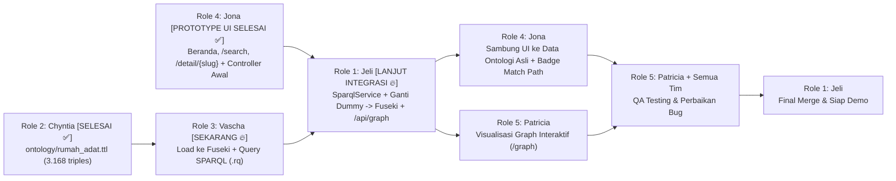

# Panduan Urutan Pengerjaan Project — Search Engine Rumah Adat Sumatera Utara

> **Terakhir Diperbarui:** 24 November 2026 (Commit `63c0ad1` — PR #50, #51, #52)

Dokumen ini menjadi **panduan langkah demi langkah** untuk **Kelompok 07** agar semua anggota tahu:
1. **Tahap mana yang sudah selesai** dan mana yang sedang berjalan sekarang,
2. **Siapa mengerjakan apa** sesuai pembagian peran,
3. **Kontrak nama route, field data, Class, dan Property asli** yang sudah ada di kode Laravel dan `ontology/rumah_adat.ttl`.

---

## 1. Pembagian Peran Tim (Kelompok 07)

| Role | Nama | Fokus Utama | Output Utama |
| :--- | :--- | :--- | :--- |
| **Role 1** | **Jeli** | Project Lead & Backend Integration | Kerangka Laravel, Service penghubung Fuseki, Controller, code review & merge branch, kestabilan saat demo |
| **Role 2** | **Chyntia** | Ontology & RDF Dataset Engineer | Dokumen data bersih, skema ontologi (Protégé/Turtle), file `ontology/rumah_adat.ttl` valid tanpa error |
| **Role 3** | **Vascha** | SPARQL Query & Semantic Logic Developer | Setup Apache Jena Fuseki, file query `.rq` (multi-hop, filter, detail, alasan keterkaitan / *match path*) |
| **Role 4** | **Jona** | UI/UX Designer & Frontend Utama | Tampilan responsif Beranda, Hasil Pencarian (+ badge alasan keterkaitan), & Halaman Detail (+ panel relasi semantik) |
| **Role 5** | **Patricia Putri** | Knowledge Graph Visualization & QA Tester | Halaman Visualisasi Knowledge Graph interaktif (`Vis.js` / `Cytoscape.js`) & hasil pengujian (QA Checklist) bebas bug |

---

## 2. Cara Kerja Aplikasi Kita (Versi Sederhana)

1. **Chyntia (Bahan Makanan & Resep — `SELESAI ✅`):** Sudah menyiapkan seluruh pengetahuan terhubung di `ontology/rumah_adat.ttl` (`42` rumah adat beserta suku, marga, bahasa, wilayah bertingkat, ornamen, tradisi, hingga hubungan kekerabatan antar-marga dan antar-suku).
2. **Vascha (Dapur & Racikan Pencarian — `TAHAP SEKARANG 🔥`):** Memasukkan `ontology/rumah_adat.ttl` ke server **Apache Jena Fuseki**, lalu menyiapkan perintah pencarian cerdas (**query SPARQL `.rq`**) supaya kalau user mengetik kata yang *tidak langsung* menyebut nama rumah adat (misalnya ketik marga, tradisi seperti `"Maena"`, ornamen, atau kabupaten), sistem tetap bisa melacak sampai ke rumah adatnya dan menjelaskan *alasan keterkaitannya*.
3. **Jeli (Pelayan / Penghubung — `PROTOTYPE CONTROLLER SUDAH ADA, SELANJUTNYA INTEGRASI FUSEKI`):** Menyiapkan **Laravel** sebagai jembatan. Saat ini route `/`, `/search`, `/detail/{slug}` dan `RumahAdatController` sudah berjalan pakai 3 data dummy; tugas berikutnya mengganti dummy tersebut dengan `SparqlService` yang memanggil query Vascha ke Fuseki + menyediakan endpoint `/graph` dan `/api/graph`.
4. **Jona (Ruang Makan & Menu — `UI PROTOTYPE SUDAH JADI ✅, SELANJUTNYA SAMBUNG KE DATA ASLI`):** Sudah membangun tampilan **Beranda, Hasil Pencarian, dan Detail** yang responsif; tugas berikutnya menampilkan atribut lengkap ontologi, *badge alasan keterkaitan*, tautan relasi semantik klikable, dan foto rumah adat.
5. **Patricia Putri (Peta Interaktif & Quality Control — `TAHAP SEKARANG 🔥`):** Mengganti diagram prototype statis dengan **peta garis hubungan interaktif (Knowledge Graph)** di `/graph` memakai `Vis.js` atau `Cytoscape.js`, sekaligus mengetes semua fitur agar bebas bug saat demo.

### Alur Kerja & Ketergantungan Antar Anggota



---

## 3. Posisi Kita Sekarang

- **Sudah selesai (`✅`):**
  - Struktur repo GitHub dan proyek **Laravel 13 + Tailwind CSS v4 + Vite** (**Jeli**).
  - **Ontologi & dataset RDF lengkap `ontology/rumah_adat.ttl`** (`3.168 triples`, valid 0 error via `dataset/cek_ttl.py`) (**Chyntia & tim**).
  - **Prototype UI & Navigasi Web End-to-End** (PR #50, #51, #52):
    - `routes/web.php`: `/` (`home`), `/search` (`search`), dan `/detail/{slug}` (`detail`).
    - `RumahAdatController.php`: filter kata kunci `q`, `suku[]`, `wilayah[]`, serta `show($slug)` (masih menggunakan **3 data dummy**).
    - `home.blade.php` (hero search, statistik `42/15/61/107`, quick explore 3 wilayah, cultural discovery, CTA).
    - `search.blade.php` (form search, sidebar filter Suku & Wilayah, kartu hasil, empty state).
    - `detail.blade.php` (profil budaya, identitas, deskripsi, sidebar semantic data, dan prototype diagram 3 node).
- **Yang harus dikerjakan mulai sekarang (`⏳`):**
  - Setup **Apache Jena Fuseki** + pembuatan file query **SPARQL `.rq`** (**Vascha**).
  - Pembuatan `SparqlService`, penggantian 3 data dummy di `RumahAdatController` dengan hasil Fuseki, plus endpoint `/graph` & `/api/graph` (**Jeli**).
  - Penambahan badge alasan keterkaitan (*match path*), atribut detail lengkap (`sejarah`, `ciriArsitektur`, `bentukAtap`, `bahanBangunan`, `maknaFilosofis`, `referensi`, marga, bahasa, ornamen, tradisi), perluasan Quick Explore Wilayah, serta foto lokal rumah adat (**Jona**).
  - Halaman Visualisasi Knowledge Graph interaktif (`Vis.js` / `Cytoscape.js`) & QA Testing (**Patricia**).

---

## 4. Urutan Pengerjaan Dari Awal Sampai Akhir

---

### FASE 0 — Persiapan Awal & Fondasi Proyek `[STATUS: SUDAH SELESAI ✅]`
*Pelaksana utama: **Jeli** & **Jona***

1. **Jeli** sudah menyiapkan repository GitHub dan proyek Laravel di `tubes_rumah_adat/`.
2. **Jona** sudah menyiapkan layout utama (`resources/views/layouts/app.blade.php`) dan fondasi frontend Tailwind v4 + Vite.

---

### FASE 1 — Kontrak Data & Skema Ontologi Final `[STATUS: SUDAH SELESAI ✅]`
*Acuan wajib bagi **Vascha, Jeli, Jona, & Patricia** saat menyambungkan Fuseki ke Laravel!*

1. **Route yang Sudah Aktif di `routes/web.php`:**
   - `GET /` → nama route `home`
   - `GET /search` → nama route `search` (`RumahAdatController@index`)
   - `GET /detail/{slug}` → nama route `detail` (`RumahAdatController@show`) *(perhatikan: URL-nya `/detail/{slug}`, bukan `/rumah-adat/{slug}`)*
   - *(Tambahan berikutnya untuk Patricia & Jeli: `GET /graph` dan `GET /api/graph`)*.
2. **7 Kelas Utama (`owl:Class`) di `ontology/rumah_adat.ttl` (`@prefix ra: <http://example.org/ontology/rumah-adat#> .`):**
   - `ra:RumahAdat` (**42** data)
   - `ra:Suku` (**15** data)
   - `ra:Marga` (**107** data)
   - `ra:BahasaDaerah` (**13** data)
   - `ra:Wilayah` (**61** data — Provinsi Sumatera Utara + Kabupaten/Kota + Desa/Kecamatan)
   - `ra:Tradisi` (**17** data — termasuk `Maena`, `Owasa`, `Hombo Batu`, `Merdang Merdem`, `Merkottas`, `Jamu Laut`, `Rondang Bintang`, `Manortor`, `Tepung Tawar`, dll.)
   - `ra:Ornamen` (**13** data)
3. **11 Object Properties:**
   - `ra:berasalDariWilayah` (`RumahAdat` / `Marga` → `ra:Wilayah`)
   - `ra:bagianDariWilayah` (**`owl:TransitiveProperty`**, `ra:Wilayah` → `ra:Wilayah`)
   - `ra:dimilikiOlehSuku` (`ra:RumahAdat` → `ra:Suku`)
   - `ra:memilikiMarga` (`ra:RumahAdat` → `ra:Marga`)
   - `ra:menggunakanBahasa` (`ra:RumahAdat` → `ra:BahasaDaerah`)
   - `ra:memilikiOrnamen` (`ra:RumahAdat` → `ra:Ornamen`)
   - `ra:memilikiTradisi` (`ra:RumahAdat` → `ra:Tradisi`)
   - `ra:menuturkanBahasa` (`ra:Suku` → `ra:BahasaDaerah`)
   - `ra:bagianDariSuku` (`ra:Marga` → `ra:Suku`)
   - `ra:berkerabatDenganMarga` (**`owl:SymmetricProperty`**, `ra:Marga` → `ra:Marga`)
   - `ra:berkerabatDenganSuku` (**`owl:SymmetricProperty`**, `ra:Suku` → `ra:Suku`)
4. **9 Datatype Properties (`ra:RumahAdat` & Label Umum):**
   - Seluruh 267 individu di 7 kelas memiliki **`ra:nama`** sekaligus **`rdfs:label`** (100% seragam).
   - Setiap `ra:RumahAdat` memiliki lengkap: `ra:nama`, `rdfs:label`, `ra:namaAlternatif`, `ra:sejarah`, `ra:fungsi`, `ra:ciriArsitektur`, `ra:bentukAtap`, `ra:bahanBangunan`, `ra:maknaFilosofis`, dan `ra:referensi`.
   - *(Catatan foto: `ra:linkFoto` sengaja dihapus dari `.ttl`; foto rumah adat disediakan di `public/images/rumah-adat/` dan dipetakan di Laravel berdasarkan `slug`).*

---

### FASE 2 — Pengolahan Data & Validasi `ontology/rumah_adat.ttl` `[STATUS: SUDAH SELESAI ✅]`
*Pelaksana utama: **Chyntia** & tim*

1. File `ontology/rumah_adat.ttl` sudah dibangun, dibersihkan, dan divalidasi (`3.168 triples`, `0` error sintaks di `python dataset/cek_ttl.py`, `0` pelanggaran domain/range, `0` wilayah daun yang menganggur).
2. **Catatan file kembar:** Gunakan selalu **`ontology/rumah_adat.ttl`** (`3.168 triples`) sebagai file resmi yang di-upload ke Fuseki. File lama `dataset/rumah_adat.ttl` (`2.739 triples`) sebaiknya dihapus agar tim tidak tertukar.

---

### FASE 3 — Pembuatan UI Prototype Halaman Beranda, Search, & Detail `[STATUS: SUDAH SELESAI ✅]`
*Pelaksana utama: **Jona** (PR #50, #51, #52)*

1. **`home.blade.php`:** Hero search bar, kartu statistik dataset (`42`, `15`, `61`, `107`), *quick explore* wilayah awal, *cultural discovery*, dan CTA sudah dibuat.
2. **`search.blade.php`:** Search bar ulang, *quick search*, sidebar filter `Suku` & `Wilayah`, kartu rumah adat, dan *empty state* sudah dibuat.
3. **`detail.blade.php`:** Hero profil, *Cultural Identity*, *Cultural Overview*, *Semantic Data*, dan *Prototype Knowledge Graph* sudah dibuat dan terhubung dari `/search` lewat `route('detail', ['slug' => ...])`.

---

### FASE 4 — Setup Apache Jena Fuseki & Membuat Query SPARQL (`.rq`) `[STATUS: PRIORITAS SEKARANG 🔥]`
*Pelaksana utama: **Vascha** (memakai `ontology/rumah_adat.ttl`)*

#### Yang Dikerjakan Vascha (Urutan Langkah):
1. **Load Dataset ke Apache Jena Fuseki:**
   - Jalankan server Fuseki (`http://localhost:3030`) dan buat dataset baru (misalnya bernama `rumah_adat`).
   - Upload **`ontology/rumah_adat.ttl`** ke dataset tersebut dan pastikan terbaca **3.168 triples**.
2. **Tulis & Uji Query SPARQL Satu Per Satu di Fuseki UI:**
   Simpan setiap query teruji ke folder `tubes_rumah_adat/resources/sparql/`:
   - **`01_statistik.rq`:** Menghitung jumlah asli `ra:RumahAdat`, `ra:Suku`, `ra:Wilayah`, `ra:Marga`, `ra:Tradisi`, `ra:Ornamen` (untuk menggantikan angka statis di `home.blade.php`).
   - **`02_search_multihop.rq`:** Pencarian kata kunci bebas (`?keyword`) yang menelusuri **lintas hubungan (multi-hop)** + filter `suku[]` dan `wilayah[]`:
     - Cocok di atribut teks (`ra:nama`, `ra:namaAlternatif`, `ra:sejarah`, `ra:ciriArsitektur`, `ra:maknaFilosofis`).
     - Cocok lewat **Wilayah bertingkat** memakai `ra:berasalDariWilayah/ra:bagianDariWilayah*` (misal cari `"Kabupaten Toba"` → ketemu rumah di Balige & Jangga Dolok).
     - Cocok lewat **Suku & Kerabat Suku** (`ra:dimilikiOlehSuku/ra:berkerabatDenganSuku?`).
     - Cocok lewat **Marga & Kerabat Marga** (`ra:memilikiMarga/ra:berkerabatDenganMarga?`).
     - Cocok lewat **Bahasa Daerah** (`ra:menggunakanBahasa` / `ra:menuturkanBahasa`).
     - Cocok lewat **Tradisi** (misal `"Maena"`, `"Hombo Batu"`) & **Ornamen** (misal `"Gorga"`, `"Lebah Bergantung"`).
   - **`03_match_path.rq` (atau kolom `?alasan` di query search):** Menghasilkan **alasan keterkaitan**, contoh:
     - Cari `"Maena"` → `Terhubung melalui Tradisi: Maena`
     - Cari `"Harahap"` → `Terhubung melalui Marga: Harahap`
     - Cari `"Kabupaten Samosir"` → `Terhubung melalui Wilayah: Pulau Samosir → Kabupaten Samosir`
   - **`04_facets.rq`:** Mengambil daftar opsi filter dinamis untuk sidebar `search.blade.php` (15 Suku, Wilayah Kabupaten/Kota/Desa, Tradisi, Ornamen).
   - **`05_detail.rq`:** Mengambil seluruh properti lengkap 1 rumah adat berdasarkan URI/slug (`nama`, `namaAlternatif`, `sejarah`, `fungsi`, `ciriArsitektur`, `bentukAtap`, `bahanBangunan`, `maknaFilosofis`, `referensi`) beserta daftar relasi (wilayah & induknya, suku & kerabat suku, marga & kerabat marga, bahasa, ornamen, tradisi).
   - **`06_knowledge_graph.rq`:** Mengambil triplet relasi (`?source`, `?sourceLabel`, `?sourceType`, `?predicate`, `?target`, `?targetLabel`, `?targetType`) untuk visualisasi graf interaktif Patricia (keseluruhan graf maupun fokus 1 rumah adat tertentu).
3. **Dokumentasikan Placeholder Parameter Query:**
   - Catat placeholder yang akan diisi oleh Laravel (misal `__KEYWORD__`, `__SLUGS__`, `__SUKU_FILTER__`, `__WILAYAH_FILTER__`).

> **Selesai jika:** Semua file `.rq` sudah diuji langsung di Fuseki UI, hasilnya akurat tanpa duplikasi baris yang membingungkan, dan sudah di-push ke branch Vascha.

---

### FASE 5 — Menghubungkan Laravel dengan Fuseki (Integrasi Backend) `[STATUS: PRIORITAS SEKARANG 🔥]`
*Pelaksana utama: **Jeli***

#### Yang Dikerjakan Jeli (Urutan Langkah):
1. **Konfigurasi Koneksi Triplestore:**
   - Tambahkan `FUSEKI_URL=http://localhost:3030` dan `FUSEKI_DATASET=rumah_adat` di `.env` dan `.env.example`, lalu daftarkan di `config/services.php`.
2. **Bangun `SparqlService` / `RumahAdatSearchService` (`app/Services/`):**
   - Membaca file `.rq` dari `resources/sparql/`.
   - Menyisipkan input user dengan **sanitasi SPARQL** yang aman.
   - Mengirim request `Http::asForm()->post(...)` (`Accept: application/sparql-results+json`) ke Fuseki.
   - Membentuk `slug` konsisten dari URI (misal `rumah_bolon_pulau_sibandang` → `rumah-bolon-pulau-sibandang` atau langsung memakai local name URI sebagai `{slug}`) dan mengelompokkan hasil agar 1 rumah adat tidak muncul dobel.
   - Menyediakan fallback ramah jika server Fuseki sedang mati.
3. **Ganti Data Dummy di `RumahAdatController.php` & Tambah Route Graf:**
   - Hapus array dummy 3 item di `getHouses()`.
   - Update `HomeController` / closure route `/` agar mengirim statistik asli & daftar wilayah ke `home.blade.php`.
   - Update `RumahAdatController@index` (`/search`) agar mengirim `houses` (lengkap dengan field `match_reasons` / `alasan_keterkaitan`), `total`, dan daftar opsi filter dinamis ke `search.blade.php`.
   - Update `RumahAdatController@show($slug)` (`/detail/{slug}`) agar mengirim seluruh atribut ontologi dan relasi lengkap ke `detail.blade.php`.
   - Tambah `GraphController` untuk `GET /graph` (`graph.blade.php`) dan `GET /api/graph` (JSON nodes & edges untuk Patricia).

> **Selesai jika:** Membuka `/search` menampilkan hingga **42** rumah adat dari Fuseki (bukan 3 data dummy lagi) dan `/detail/{slug}` menampilkan seluruh properti dari `ontology/rumah_adat.ttl`.

---

### FASE 6 — Penyempurnaan UI Data Asli & Visualisasi Knowledge Graph Interaktif
*Pelaksana utama: **Jona** (UI Data Asli) & **Patricia Putri** (Knowledge Graph)*

#### Yang Dikerjakan Jona:
1. **Beranda (`home.blade.php`):**
   - Sambungkan `$statistics` ke angka dinamis dari backend (bukan array hardcoded di Blade).
   - Perluas **Quick Explore Wilayah** agar mencakup wilayah budaya utama Sumatera Utara (tidak hanya 3 kartu).
2. **Hasil Pencarian (`search.blade.php`):**
   - Hapus badge `DATA AWAL` dan ganti chip statis pada kartu menjadi **Badge Alasan Keterkaitan (*match path*)** dari SPARQL (misal *"Cocok via Tradisi: Maena"*, *"Cocok via Marga: Harahap"*).
   - Sambungkan sidebar filter Suku/Wilayah (+ tambah filter Tradisi/Ornamen bila perlu) ke opsi dinamis dari ontologi (termasuk `Melayu`, `Pakpak`, `Mandailing`, `Angkola`, `Pasisi`, `Nias`, `Toba`, `Karo`, `Simalungun`).
   - Tambahkan gambar kartu rumah adat dari `public/images/rumah-adat/`.
3. **Halaman Detail (`detail.blade.php`):**
   - Tampilkan seluruh field lengkap ontologi (`namaAlternatif`, `sejarah`, `fungsi`, `ciriArsitektur`, `bentukAtap`, `bahanBangunan`, `maknaFilosofis`, `referensi`) dan hapus catatan *"data demonstrasi"*.
   - Ubah daftar relasi (Wilayah, Suku, Bahasa, Marga, Ornamen, Tradisi) di `03 — SEMANTIC DATA` menjadi tautan/chip klikable yang mengarah ke `/search` terkait.
   - Ganti kotak *"Prototype Visualization"* di `04 — KNOWLEDGE GRAPH` agar terhubung ke visualisasi dinamis atau tombol *"Buka Knowledge Graph Interaktif"* (`/graph?focus={slug}`).

#### Yang Dikerjakan Patricia Putri:
1. **Bangun Halaman `/graph` (`resources/views/pages/graph.blade.php`) & Navbar:**
   - Tambahkan link **Knowledge Graph** (`/graph`) di `layouts/app.blade.php`.
   - Pasang **Vis.js (`vis-network`)** atau **Cytoscape.js** di `graph.blade.php` (dan/atau `resources/js/app.js`).
2. **Visualisasi Dinamis dari `/api/graph`:**
   - Tampilkan *nodes* dengan warna berbeda untuk 7 kelas (`RumahAdat`, `Suku`, `Marga`, `Wilayah`, `BahasaDaerah`, `Tradisi`, `Ornamen`) dan *edges* berlabel relasi.
   - Tambahkan interaktivitas: klik node untuk melihat info singkat / menuju `/detail/{slug}`, zoom, pan, serta filter fokus per rumah adat atau per wilayah/suku.

---

### FASE 7 — Pengujian Menyeluruh (QA), Perbaikan Bug, & Persiapan Demo
*Pelaksana utama: **Patricia Putri** (QA) + **Jeli** (Final Merge) + **Semua Anggota** (Perbaikan)*

#### Checklist Pengujian oleh Patricia Putri (`QA_CHECKLIST.md`):
1. **Uji Pencarian Tidak Langsung (Multi-Hop):**
   - Cari **Suku** (mis. `"Batak Karo"`) → Rumah Karo di Lingga, Dokan, & Karo Jahe Deli Serdang muncul.
   - Cari **Marga** (mis. `"Harahap"`, `"Telaumbanua"`, `"Ginting"`, `"Tengku"`) → Rumah adat terkait muncul dengan badge alasan keterkaitan yang tepat.
   - Cari **Bahasa** (mis. `"Bahasa Nias"`, `"Bahasa Simalungun"`) → Rumah adat terkait muncul.
   - Cari **Wilayah induk** (mis. `"Kabupaten Toba"`, `"Kabupaten Samosir"`, `"Kabupaten Asahan"`) → Rumah adat bawahannya ikut muncul via `bagianDariWilayah*`.
   - Cari **Tradisi / Ornamen** (mis. `"Maena"`, `"Hombo Batu"`, `"Gorga"`, `"Tepung Tawar"`) → Rumah adat terkait muncul.
   - Uji huruf besar/kecil (*case-insensitive*) dan kata kunci acak (*empty state*).
2. **Uji UI, Responsivitas, Gambar, & Graph:**
   - Klik semua tombol *Quick Explore Wilayah*, filter checkbox di `/search`, tautan relasi di `/detail/{slug}`, dan interaksi node di `/graph`.
   - Pastikan seluruh foto di `public/images/rumah-adat/` tampil (tidak pecah) dan referensi tampil rapi di mobile maupun desktop.
3. **Pelaporan Bug:**
   - Data RDF / relasi salah → **Chyntia**
   - Query SPARQL / alasan keterkaitan keliru → **Vascha**
   - Error controller / Fuseki / JSON → **Jeli**
   - UI / layout / responsivitas → **Jona**
   - Error/tumpang tindih grafik Vis.js/Cytoscape.js → **Patricia**

#### Finalisasi Oleh Jeli (Menjelang Demo):
1. Review dan merge seluruh branch ke `main`, lalu hapus duplikat lama `dataset/rumah_adat.ttl` agar hanya `ontology/rumah_adat.ttl` (`3.168 triples`) yang dipakai.
2. Jalankan `npm run build` dan hapus `public/hot` bila Vite dev server dimatikan.
3. Tambahkan minimal *Feature Test* di `tests/Feature/` untuk `/`, `/search`, `/detail/{slug}`, dan `/graph`.
4. Uji skenario demo penuh: **Fuseki menyala (`ontology/rumah_adat.ttl`) + Laravel berjalan stabil**.

---

## 5. Ringkasan Cepat: "Sekarang Saya Harus Ngapain?"

| Anggota | Yang Sudah Selesai ✅ | Fokus Tugas Sekarang 🔥 | Tugas Akhir (Menjelang Demo) |
| :--- | :--- | :--- | :--- |
| **Chyntia** | `ontology/rumah_adat.ttl` final (`3.168 triples`) | Hapus duplikat lama `dataset/rumah_adat.ttl` + bantu koreksi data jika ada kebutuhan dari query/UI | Perbaiki data RDF jika ditemukan temuan saat QA |
| **Vascha** | Siap mulai dengan dataset final | Load `ontology/rumah_adat.ttl` ke **Apache Jena Fuseki** + tulis & uji semua file `.rq` di `resources/sparql/` | Optimalkan query multi-hop & *match path* jika ada temuan QA |
| **Jeli** | Skeleton Laravel + merge PR #50–#52 | Buat `SparqlService`, ganti 3 dummy `RumahAdatController` dengan Fuseki, tambah `/graph` & `/api/graph` | Code review, merge semua PR ke `main`, build aset, jaga kestabilan demo |
| **Jona** | UI prototype Beranda, `/search`, & `/detail/{slug}` | Sambungkan UI ke data asli (`match_reasons`, detail lengkap ontologi, quick explore diperluas) + lengkapi foto di `public/images/rumah-adat/` | Perbaiki UI/responsivitas berdasarkan catatan QA |
| **Patricia Putri** | Siap mulai bangun visualisasi | Buat halaman `/graph` (`Vis.js` / `Cytoscape.js`) dari `/api/graph` + susun `QA_CHECKLIST.md` | Jalankan QA penuh (uji multi-hop, filter, detail, graf, foto) sampai bebas bug |

---

## 6. Aturan Praktis GitHub Kelompok

1. **Jangan ngoding langsung di branch `main`.** Gunakan branch per fitur (misal `feat/sparql-queries`, `feat/backend-fuseki`, `feat/frontend-integration`, `feat/knowledge-graph`).
2. **Sebelum mulai kerja**, selalu tarik update terbaru dari `main`:
   ```bash
   git checkout main
   git pull origin main
   ```
3. **Setiap selesai 1 fitur yang sudah dites**, buat *Pull Request (PR)* ke `main` agar **Jeli** dapat melakukan *review & merge*.
