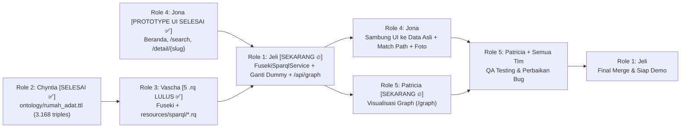

# Panduan Urutan Pengerjaan Project — Search Engine Rumah Adat Sumatera Utara

> **Terakhir Diperbarui:** 24 November 2026 (Commit `2f3aac2` — PR #50–#53 + penyempurnaan `search.rq` & `graph.rq`)

Dokumen ini menjadi **panduan langkah demi langkah** untuk **Kelompok 07** agar semua anggota tahu:
1. **Tahap mana yang sudah selesai** dan apa yang perlu dirapikan sekarang,
2. **Siapa mengerjakan apa** sesuai pembagian peran,
3. **Kontrak file `.rq`, route Laravel, dan skema `ontology/rumah_adat.ttl`** yang dipakai bersama.

---

## 1. Pembagian Peran Tim (Kelompok 07)

| Role | Nama | Fokus Utama | Output Utama |
| :--- | :--- | :--- | :--- |
| **Role 1** | **Jeli** | Project Lead & Backend Integration | Kerangka Laravel, `FusekiSparqlService`, Controller, code review & merge branch, kestabilan saat demo |
| **Role 2** | **Chyntia** | Ontology & RDF Dataset Engineer | Dokumen data bersih, skema ontologi (Protégé/Turtle), file `ontology/rumah_adat.ttl` valid tanpa error |
| **Role 3** | **Vascha** | SPARQL Query & Semantic Logic Developer | Setup Apache Jena Fuseki, 5 file query `.rq` di `resources/sparql/` (multi-hop, filter, detail, alasan keterkaitan / *match path*) |
| **Role 4** | **Jona** | UI/UX Designer & Frontend Utama | Tampilan responsif Beranda, Hasil Pencarian (+ badge alasan keterkaitan), & Halaman Detail (+ panel relasi semantik) |
| **Role 5** | **Patricia Putri** | Knowledge Graph Visualization & QA Tester | Halaman Visualisasi Knowledge Graph interaktif (`Vis.js` / `Cytoscape.js`) & hasil pengujian (QA Checklist) bebas bug |

---

## 2. Cara Kerja Aplikasi Kita (Versi Sederhana)

1. **Chyntia (`SELESAI ✅`):** Sudah menyiapkan pengetahuan terhubung di `ontology/rumah_adat.ttl` (`42` rumah adat beserta suku, marga, bahasa, wilayah bertingkat, ornamen, tradisi, serta kekerabatan marga dan suku).
2. **Vascha (`5 FILE .rq SELESAI & LULUS UJI ✅`):** Sudah membuat 5 file query di `resources/sparql/` (`stats.rq`, `filters.rq`, `detail.rq`, `search.rq`, `graph.rq`); `search.rq` dan `graph.rq` juga sudah disempurnakan dan seluruhnya lulus uji terhadap `ontology/rumah_adat.ttl` (`3.168 triples`). Tinggal memastikan dataset `ontology/rumah_adat.ttl` aktif di server Fuseki (`/rumah_adat`).
3. **Jeli (`PRIORITAS SEKARANG 🔥`):** Menghubungkan Laravel dengan Fuseki lewat `FusekiSparqlService`, mengganti 3 data dummy di `RumahAdatController` dengan hasil query Vascha, serta menyiapkan route `/graph` dan `/api/graph`.
4. **Jona (`UI PROTOTYPE SUDAH JADI ✅, SELANJUTNYA SAMBUNG KE DATA ASLI`):** Sudah membuat Beranda, `/search`, dan `/detail/{slug}`; selanjutnya menampilkan *badge alasan keterkaitan*, detail lengkap ontologi, perluasan wilayah di Beranda, dan foto lokal.
5. **Patricia Putri (`PRIORITAS SEKARANG 🔥`):** Membangun halaman `/graph` (`Vis.js` / `Cytoscape.js`) memakai data `/api/graph` dan menjalankan QA checklist pada seluruh skenario pencarian tidak langsung (*multi-hop*).

### Alur Kerja & Ketergantungan Antar Anggota

---

## 3. Posisi Kita Sekarang

- **Sudah selesai (`✅`):**
  - Struktur repo GitHub dan proyek **Laravel 13 + Tailwind CSS v4 + Vite** (**Jeli**).
  - **Ontologi & dataset RDF `ontology/rumah_adat.ttl`** (`3.168 triples`, valid `0` error di `dataset/cek_ttl.py`) (**Chyntia & tim**).
  - **Prototype UI & Navigasi Web** (PR #50, #51, #52): `routes/web.php` (`/`, `/search`, `/detail/{slug}`), `RumahAdatController.php` (3 dummy), `home.blade.php`, `search.blade.php`, dan `detail.blade.php` (**Jona**).
  - **5 File Query SPARQL di `resources/sparql/`** (PR #53 + penyempurnaan `search.rq` & `graph.rq`): `stats.rq`, `filters.rq`, `detail.rq`, `search.rq`, dan `graph.rq` seluruhnya lulus uji terhadap `ontology/rumah_adat.ttl` (**Vascha**).
- **Yang harus dikerjakan mulai sekarang (`⏳`):**
  - Memastikan Fuseki lokal (`http://localhost:3030`) aktif memuat `ontology/rumah_adat.ttl` di dataset `/rumah_adat` (**Vascha**).
  - Pembuatan `FusekiSparqlService`, penggantian 3 dummy di `RumahAdatController` dengan Fuseki, serta pembuatan route `/graph` & `/api/graph` (**Jeli**).
  - Penambahan *badge alasan keterkaitan*, detail lengkap ontologi (`sejarah`, `ciriArsitektur`, `bentukAtap`, `bahanBangunan`, `maknaFilosofis`, `referensi`, marga, bahasa, ornamen, tradisi), perluasan Quick Explore Wilayah, serta foto lokal di `public/images/rumah-adat/` (**Jona**).
  - Halaman Visualisasi Knowledge Graph (`/graph`) & QA Checklist (**Patricia Putri**).

---

## 4. Urutan Pengerjaan Dari Awal Sampai Akhir

---

### FASE 0 — Persiapan Awal & Fondasi Proyek `[STATUS: SUDAH SELESAI ✅]`
*Pelaksana utama: **Jeli** & **Jona***

1. Kerangka Laravel 13, Tailwind CSS v4, Vite, dan layout dasar (`layouts/app.blade.php`) sudah siap.

---

### FASE 1 — Kontrak Data & Skema Ontologi Final `[STATUS: SUDAH SELESAI ✅]`
*Acuan resmi untuk seluruh tim:*

1. **Route yang Sudah Aktif (`routes/web.php`):**
   - `GET /` → `home`
   - `GET /search` → `search` (`RumahAdatController@index`)
   - `GET /detail/{slug}` → `detail` (`RumahAdatController@show`) *(perhatikan: URL `/detail/{slug}`, bukan `/rumah-adat/{slug}`)*
   - *(Tambahan berikutnya untuk Fase 5 & 6: `GET /graph` dan `GET /api/graph`)*.
2. **7 Kelas Inti di `ontology/rumah_adat.ttl` (`@prefix ra: <http://example.org/ontology/rumah-adat#> .`):**
   - `ra:RumahAdat` (`42`), `ra:Suku` (`15`), `ra:Marga` (`107`), `ra:BahasaDaerah` (`13`), `ra:Wilayah` (`61`), `ra:Tradisi` (`17`), `ra:Ornamen` (`13`).
   - Seluruh `267` individu memiliki `ra:nama` dan `rdfs:label`.
3. **11 Object Properties & 9 Datatype Properties:**
   - Object: `ra:berasalDariWilayah`, `ra:bagianDariWilayah` (`owl:TransitiveProperty`), `ra:dimilikiOlehSuku`, `ra:memilikiMarga`, `ra:menggunakanBahasa`, `ra:memilikiOrnamen`, `ra:memilikiTradisi`, `ra:menuturkanBahasa`, `ra:bagianDariSuku`, `ra:berkerabatDenganMarga` (`owl:SymmetricProperty`), `ra:berkerabatDenganSuku` (`owl:SymmetricProperty`).
   - Datatype pada `RumahAdat`: `ra:nama`, `ra:namaAlternatif`, `ra:sejarah`, `ra:fungsi`, `ra:ciriArsitektur`, `ra:bentukAtap`, `ra:bahanBangunan`, `ra:maknaFilosofis`, `ra:referensi`. *(Foto disediakan di `public/images/rumah-adat/`, bukan dari TTL).*

---

### FASE 2 — Pengolahan Data & Validasi `ontology/rumah_adat.ttl` `[STATUS: SUDAH SELESAI ✅]`
*Pelaksana utama: **Chyntia** & tim*

1. File `ontology/rumah_adat.ttl` sudah final (`3.168 triples`) dan lolos `python dataset/cek_ttl.py` (`0` error).
2. **Catatan file kembar:** Gunakan selalu **`ontology/rumah_adat.ttl` (`3.168 triples`)**, jangan gunakan salinan lama `dataset/rumah_adat.ttl` (`2.739 triples`) — sebaiknya hapus `dataset/rumah_adat.ttl` saat bersih-bersih repo.

---

### FASE 3 — Pembuatan UI Prototype Halaman Beranda, Search, & Detail `[STATUS: SUDAH SELESAI ✅]`
*Pelaksana utama: **Jona** (PR #50, #51, #52)*

1. `home.blade.php`, `search.blade.php`, dan `detail.blade.php` sudah dibuat lengkap beserta filter dasar dan prototype visualisasi 3 node.

---

### FASE 4 — Setup Apache Jena Fuseki & Query SPARQL (`.rq`) `[STATUS: 5 FILE .rq SELESAI & LULUS UJI ✅]`
*Pelaksana utama: **Vascha** (PR #53 + penyempurnaan `search.rq` & `graph.rq`)*

#### Yang Sudah Selesai & Lulus Uji (`resources/sparql/`):
- `stats.rq`: menghitung `42` RumahAdat, `15` Suku, `107` Marga, `61` Wilayah, `17` Tradisi, `13` Ornamen, `13` BahasaDaerah (**Lulus 100%**).
- `filters.rq`: mengambil `226` opsi filter kategori `suku`, `wilayah`, `tradisi`, `ornamen`, `bahasa`, `marga` (**Lulus 100%**).
- `detail.rq`: menarik seluruh atribut lengkap + 6 `GROUP_CONCAT` relasi untuk 1 rumah adat (**Lulus pada 42/42 rumah adat**).
- `search.rq`: query pencarian *multi-hop* 11 cabang `UNION` (skor `55`–`100`: nama rumah, marga langsung/berkerabat, nama alternatif, suku langsung/berkerabat, wilayah transitif, bahasa, tradisi, ornamen, serta deskripsi/arsitektur) dengan `BIND(LCASE("laia") AS ?ql)` dan `FILTER(?ql != "" && CONTAINS(...))` di luar `UNION` (**Lulus: `"laia"` `36` baris / `4` rumah, `"maena"` `7` baris / `4` rumah, `"Sopo Godang"` `11` baris / `7` rumah, `"Arsitektur"` `20` baris / `18` rumah, `"Kabupaten Toba"` `8` baris / `3` rumah, `""` `0` baris**).
- `graph.rq`: query triplet graf 7 kelas domain dengan prioritas edge `RumahAdat` (`?priority`), `ORDER BY`, dan `LIMIT 600` tanpa triple TBox `rdfs:domain`/`rdfs:range` (**Lulus: `600` baris, `0` `"Entity"`, mencakup seluruh `42` `RumahAdat`**).

#### Verifikasi Server Fuseki Sebelum Integrasi Penuh:
1. **Pastikan Dataset di Fuseki UI (`http://localhost:3030`):**
   - Upload **`ontology/rumah_adat.ttl`** ke dataset `/rumah_adat` (*Persistent*) dan pastikan `3.168 triples` terbaca serta kelima file `.rq` di `resources/sparql/` jalan lancar saat diuji di tab SPARQL Query Fuseki.

---

### FASE 5 — Menghubungkan Laravel dengan Fuseki (Integrasi Backend) `[STATUS: PRIORITAS SEKARANG 🔥]`
*Pelaksana utama: **Jeli***

1. **Konfigurasi Triplestore:**
   - Tambahkan `FUSEKI_URL=http://localhost:3030` dan `FUSEKI_DATASET=rumah_adat` di `.env` & `.env.example`, lalu daftarkan di `config/services.php`.
2. **Buat `FusekiSparqlService` (`app/Services/`):**
   - Membaca template `.rq` dari `resources/sparql/`.
   - Mensanitasi input `q` dan filter (hindari karakter pemecah string SPARQL seperti `"`, `\`, `{`, `}`).
   - Mengirim `Http::asForm()->post(...)` ke endpoint `/rumah_adat/query` dengan header `Accept: application/sparql-results+json`.
   - Mengelompokkan hasil `search.rq` per URI rumah adat (menggabungkan daftar `matchPath` dan mengambil `relevanceScore` tertinggi agar 1 rumah tidak tampil berulang kali) dan memetakan `slug` ↔ URI lokal `ra:rumah_...`.
   - Menyediakan mapping gambar lokal dari `public/images/rumah-adat/` (+ fallback gambar default).
3. **Update Controller & Route (`routes/web.php`, `RumahAdatController.php`):**
   - Hapus 3 array dummy `getHouses()`.
   - Kirim data `stats.rq` & wilayah populer ke `home.blade.php`.
   - Hubungkan `RumahAdatController@index` (`/search`) ke `search.rq` + `filters.rq` (dukung query kosong `q=""` dengan daftar seluruh rumah + filter `suku[]`, `wilayah[]`, dll.).
   - Hubungkan `RumahAdatController@show($slug)` (`/detail/{slug}`) ke `detail.rq`.
   - Buat `GraphController` untuk `GET /graph` dan `GET /api/graph` (membaca `graph.rq` dan mengubahnya ke format JSON `nodes` + `edges` untuk Vis-Network).

> **Selesai jika:** `/search` menampilkan hingga **42** rumah adat dari Fuseki dan `/detail/{slug}` menampilkan data asli `ontology/rumah_adat.ttl`.

---

### FASE 6 — Penyempurnaan UI Data Asli & Visualisasi Knowledge Graph Interaktif `[STATUS: SIAP DIKERJAKAN]`
*Pelaksana utama: **Jona** (UI Data Asli) & **Patricia Putri** (Knowledge Graph)*

#### Yang Dikerjakan Jona:
1. **Beranda (`home.blade.php`):** Sambungkan angka statistik (`42`, `15`, `61`, `107`) ke data asli backend dan perluas *Quick Explore Wilayah* agar mencakup wilayah utama lain (seperti Nias, Toba, Mandailing/Angkola, Deli/Melayu, Pakpak, dll.).
2. **Hasil Pencarian (`search.blade.php`):**
   - Hapus label `DATA AWAL` dan tampilkan **Badge Alasan Keterkaitan (`matchPath`)** pada setiap kartu (contoh: *"Marga langsung: Laia"* atau *"Tradisi: Maena"*).
   - Sambungkan sidebar filter ke opsi dinamis dari `filters.rq` (Suku, Wilayah, Tradisi, Ornamen) + tampilkan gambar kartu dari `public/images/rumah-adat/`.
3. **Halaman Detail (`detail.blade.php`):**
   - Tampilkan seluruh field ontologi (`namaAlternatif`, `sejarah`, `fungsi`, `ciriArsitektur`, `bentukAtap`, `bahanBangunan`, `maknaFilosofis`, `referensi`) dan hapus teks catatan *"data demonstrasi"*.
   - Tampilkan relasi Suku, Wilayah, Bahasa, Marga, Ornamen, dan Tradisi sebagai chip/tautan klikable menuju `/search`.
   - Hubungkan panel `04 — KNOWLEDGE GRAPH` ke halaman `/graph?focus={slug}`.

#### Yang Dikerjakan Patricia Putri:
1. **Halaman `/graph` (`resources/views/pages/graph.blade.php`) & Navbar:**
   - Tambahkan tautan menu **Knowledge Graph** (`/graph`) di `layouts/app.blade.php`.
   - Pasang **Vis.js (`vis-network`)** atau **Cytoscape.js**.
2. **Visualisasi Dinamis dari `/api/graph`:**
   - Bedakan warna node untuk 7 kelas (`RumahAdat`, `Suku`, `Marga`, `Wilayah`, `BahasaDaerah`, `Tradisi`, `Ornamen`) dan tampilkan label relasi pada garisnya.
   - Tambahkan interaktivitas: klik node untuk melihat info singkat / pindah ke `/detail/{slug}`, zoom, pan, serta filter fokus per rumah adat atau per wilayah.

---

### FASE 7 — Pengujian Menyeluruh (QA), Perbaikan Bug, & Persiapan Demo
*Pelaksana utama: **Patricia Putri** (QA) + **Jeli** (Final Merge) + **Semua Anggota***

1. **QA Multi-Hop oleh Patricia (`QA_CHECKLIST.md`):**
   - Uji pencarian via **Suku**, **Marga langsung & Marga kerabat** (mis. `"Laia"`, `"Harahap"`, `"Ginting"`, `"Tengku"`), **Bahasa**, **Wilayah induk** (`"Kabupaten Toba"`, `"Kabupaten Samosir"` via `bagianDariWilayah*`), **Tradisi** (`"Maena"`, `"Hombo Batu"`), dan **Ornamen** (`"Gorga"`).
   - Uji *empty state*, responsivitas mobile/desktop, foto di `public/images/rumah-adat/`, serta interaksi `/graph`.
2. **Finalisasi Oleh Jeli:**
   - Merge seluruh PR ke `main`, hapus file sisa `dataset/rumah_adat.ttl` dan `public/hot`, jalankan `npm run build`, tambahkan Feature Test di `tests/Feature/`, dan pastikan Fuseki + Laravel siap demo.

---

## 5. Ringkasan Cepat: "Sekarang Saya Harus Ngapain?"

| Anggota | Yang Sudah Selesai ✅ | Fokus Tugas Sekarang 🔥 | Tugas Akhir (Menjelang Demo) |
| :--- | :--- | :--- | :--- |
| **Chyntia** | `ontology/rumah_adat.ttl` final (`3.168 triples`) | Hapus duplikat lama `dataset/rumah_adat.ttl` + bantu cek data jika ada temuan | Perbaiki data RDF bila ditemukan bug saat QA |
| **Vascha** | 5 file `.rq` di `resources/sparql/` selesai & lulus uji (`stats`, `filters`, `detail`, `search`, `graph`) | Pastikan Fuseki `/rumah_adat` aktif memuat `ontology/rumah_adat.ttl` untuk integrasi Laravel | Optimalkan query *multi-hop* & *match path* saat QA |
| **Jeli** | Skeleton Laravel + merge PR #50–#53 | Buat `FusekiSparqlService`, sambungkan `RumahAdatController` ke Fuseki, tambah `/graph` & `/api/graph` | Code review, merge semua PR ke `main`, build aset, jaga demo |
| **Jona** | UI prototype Beranda, `/search`, & `/detail/{slug}` | Sambungkan UI ke data asli (`matchPath`, detail lengkap, filter dinamis) + lengkapi foto lokal | Perbaiki UI/responsivitas berdasarkan catatan QA |
| **Patricia Putri** | Siap mulai bangun visualisasi | Buat halaman `/graph` (`Vis.js` / `Cytoscape.js`) dari `/api/graph` + susun `QA_CHECKLIST.md` | Jalankan QA penuh (multi-hop, filter, detail, graf, foto) sampai bebas bug |
