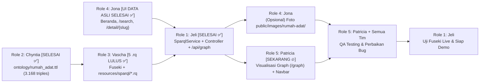

# Panduan Urutan Pengerjaan Project — Search Engine Rumah Adat Sumatera Utara

> **Terakhir Diperbarui:** 24 November 2026 (Commit `9d53235` — *Menghubungkan Laravel dengan Fuseki (Integrasi Backend)*)

Dokumen ini menjadi **panduan langkah demi langkah** untuk **Kelompok 07** agar semua anggota tahu:
1. **Tahap mana yang sudah selesai** dan apa yang perlu dirapikan sekarang,
2. **Siapa mengerjakan apa** sesuai pembagian peran,
3. **Kontrak file `.rq`, route Laravel, dan skema `ontology/rumah_adat.ttl`** yang dipakai bersama.

---

## 1. Pembagian Peran Tim (Kelompok 07)

| Role | Nama | Fokus Utama | Output Utama |
| :--- | :--- | :--- | :--- |
| **Role 1** | **Jeli** | Project Lead & Backend Integration | Kerangka Laravel, `FusekiSparqlService`, Controller, code review & merge branch, kestabilan saat demo |
| **Role 2** | **Chyntia** | Ontology & RDF Dataset Engineer | Dokumen data bersih, skema ontologi (Protégé/Turtle), file `ontology/rumah_adat.ttl` valid tanpa error |
| **Role 3** | **Vascha** | SPARQL Query & Semantic Logic Developer | Setup Apache Jena Fuseki, 5 file query `.rq` di `resources/sparql/` (multi-hop, filter, detail, alasan keterkaitan / *match path*) |
| **Role 4** | **Jona** | UI/UX Designer & Frontend Utama | Tampilan responsif Beranda, Hasil Pencarian (+ badge alasan keterkaitan), & Halaman Detail (+ panel relasi semantik) |
| **Role 5** | **Patricia Putri** | Knowledge Graph Visualization & QA Tester | Halaman Visualisasi Knowledge Graph interaktif (`Vis.js` / `Cytoscape.js`) & hasil pengujian (QA Checklist) bebas bug |

---

## 2. Cara Kerja Aplikasi Kita (Versi Sederhana)

1. **Chyntia (`SELESAI ✅`):** Sudah menyiapkan pengetahuan terhubung di `ontology/rumah_adat.ttl` (`42` rumah adat beserta suku, marga, bahasa, wilayah bertingkat, ornamen, tradisi, serta kekerabatan marga dan suku).
2. **Vascha (`5 FILE .rq SELESAI & LULUS UJI ✅`):** Sudah membuat 5 file query di `resources/sparql/` (`stats.rq`, `filters.rq`, `detail.rq`, `search.rq`, `graph.rq`); `search.rq` dan `graph.rq` juga sudah disempurnakan dan seluruhnya lulus uji terhadap `ontology/rumah_adat.ttl` (`3.168 triples`). Tinggal menyalakan server Fuseki (`/rumah_adat`) saat pengujian web.
3. **Jeli (`SELESAI ✅`):** Sudah menghubungkan Laravel ke Fuseki lewat `App\Services\SparqlService`, mengganti array dummy `getHouses()` di `RumahAdatController`, menambahkan `GET /graph` (*placeholder* netral) & `GET /api/graph`, serta membuat `RumahAdatSparqlTest` (`9/9` lulus).
4. **Jona (`UI DATA ASLI SELESAI ✅; OPSIONAL FOTO LOKAL`):** `home.blade.php`, `search.blade.php`, dan `detail.blade.php` sudah memakai data asli Fuseki tanpa teks dummy (`DATA AWAL` / *data demonstrasi* dihapus); tinggal menambah file foto rumah adat ke `public/images/rumah-adat/{slug}.jpg` bila dibutuhkan.
5. **Patricia Putri (`PRIORITAS SEKARANG 🔥`):** Mengisi halaman `/graph` (`resources/views/pages/graph.blade.php`) menggunakan **Vis.js (`vis-network`)** / **Cytoscape.js** dari `/api/graph`, menambahkan tautan **Knowledge Graph** di `layouts/app.blade.php`, filter fokus rumah adat/wilayah, dan menjalankan `QA_CHECKLIST.md`.

### Alur Kerja & Ketergantungan Antar Anggota

---

## 3. Posisi Kita Sekarang

- **Sudah selesai (`✅`):**
  - Struktur repo GitHub dan proyek **Laravel 13 + Tailwind CSS v4 + Vite** + `laravel/boost` & Pint (**Jeli**).
  - **Ontologi & dataset RDF `ontology/rumah_adat.ttl`** (`3.168 triples`, valid `0` error di `dataset/cek_ttl.py`) (**Chyntia & tim**).
  - **5 File Query SPARQL di `resources/sparql/`** (PR #53 + commit `6f54bab`): `stats.rq`, `filters.rq`, `detail.rq`, `search.rq`, dan `graph.rq` seluruhnya lulus uji terhadap `ontology/rumah_adat.ttl` (**Vascha**).
  - **Integrasi Backend Laravel ↔ Fuseki** (`App\Services\SparqlService`, `.env`/`.env.example`, `config/services.php`, `RumahAdatController`, 5 route termasuk `/graph` placeholder & `/api/graph`, serta `RumahAdatSparqlTest` `9` test / `39` assertions lulus) (**Jeli**).
  - **UI Beranda, Search, & Detail Data Asli** (statistik dinamis & 6 Quick Explore Wilayah di `home.blade.php`, filter dinamis & badge `matchPaths`/skor di `search.blade.php`, detail lengkap ontologi + chip relasi klikable + auto-deteksi foto lokal di `detail.blade.php`) (**Jona**).
- **Yang harus dikerjakan mulai sekarang (`⏳`):**
  - Menyalakan server **Apache Jena Fuseki** lokal (`http://localhost:3030`) dengan dataset `/rumah_adat` memuat `ontology/rumah_adat.ttl` (`3.168 triples`) untuk pengujian web langsung (**Jeli / Vascha**).
  - Halaman Visualisasi Knowledge Graph interaktif (`resources/views/pages/graph.blade.php`), tautan menu navbar di `layouts/app.blade.php`, filter fokus rumah adat/wilayah, dan QA Checklist (`QA_CHECKLIST.md`) (**Patricia Putri**).
  - *(Opsional)* Penambahan koleksi file foto per rumah adat di `public/images/rumah-adat/{slug}.jpg` (**Jona**).

---

## 4. Urutan Pengerjaan Dari Awal Sampai Akhir

---

### FASE 0 — Persiapan Awal & Fondasi Proyek `[STATUS: SUDAH SELESAI ✅]`
*Pelaksana utama: **Jeli** & **Jona***

1. Kerangka Laravel 13, Tailwind CSS v4, Vite, dan layout dasar (`layouts/app.blade.php`) sudah siap.

---

### FASE 1 — Kontrak Data & Skema Ontologi Final `[STATUS: SUDAH SELESAI ✅]`
*Acuan resmi untuk seluruh tim:*

1. **Route yang Sudah Aktif (`routes/web.php`):**
   - `GET /` → `home` (`RumahAdatController@index`)
   - `GET /search` → `search` (`RumahAdatController@search`)
   - `GET /detail/{slug}` → `detail` (`RumahAdatController@detail`) *(perhatikan: URL `/detail/{slug}`, bukan `/rumah-adat/{slug}`)*
   - `GET /graph` → `graph` (`RumahAdatController@graph` — placeholder siap diisi Patricia)
   - `GET /api/graph` → `api.graph` (`RumahAdatController@apiGraph`)
2. **7 Kelas Inti di `ontology/rumah_adat.ttl` (`@prefix ra: <http://example.org/ontology/rumah-adat#> .`):**
   - `ra:RumahAdat` (`42`), `ra:Suku` (`15`), `ra:Marga` (`107`), `ra:BahasaDaerah` (`13`), `ra:Wilayah` (`61`), `ra:Tradisi` (`17`), `ra:Ornamen` (`13`).
   - Seluruh `267` individu memiliki `ra:nama` dan `rdfs:label`.
3. **11 Object Properties & 9 Datatype Properties:**
   - Object: `ra:berasalDariWilayah`, `ra:bagianDariWilayah` (`owl:TransitiveProperty`), `ra:dimilikiOlehSuku`, `ra:memilikiMarga`, `ra:menggunakanBahasa`, `ra:memilikiOrnamen`, `ra:memilikiTradisi`, `ra:menuturkanBahasa`, `ra:bagianDariSuku`, `ra:berkerabatDenganMarga` (`owl:SymmetricProperty`), `ra:berkerabatDenganSuku` (`owl:SymmetricProperty`).
   - Datatype pada `RumahAdat`: `ra:nama`, `ra:namaAlternatif`, `ra:sejarah`, `ra:fungsi`, `ra:ciriArsitektur`, `ra:bentukAtap`, `ra:bahanBangunan`, `ra:maknaFilosofis`, `ra:referensi`. *(Foto disediakan di `public/images/rumah-adat/`, bukan dari TTL).*

---

### FASE 2 — Pengolahan Data & Validasi `ontology/rumah_adat.ttl` `[STATUS: SUDAH SELESAI ✅]`
*Pelaksana utama: **Chyntia** & tim*

1. File `ontology/rumah_adat.ttl` sudah final (`3.168 triples`) dan lolos `python dataset/cek_ttl.py` (`0` error).
2. **Catatan file kembar:** Gunakan selalu **`ontology/rumah_adat.ttl` (`3.168 triples`)**, jangan gunakan salinan lama `dataset/rumah_adat.ttl` (`2.739 triples`) — sebaiknya hapus `dataset/rumah_adat.ttl` saat bersih-bersih repo.

---

### FASE 3 — Pembuatan UI Prototype Halaman Beranda, Search, & Detail `[STATUS: SUDAH SELESAI ✅]`
*Pelaksana utama: **Jona** (PR #50, #51, #52)*

1. `home.blade.php`, `search.blade.php`, dan `detail.blade.php` sudah dibuat lengkap beserta filter dasar dan prototype visualisasi 3 node.

---

### FASE 4 — Setup Apache Jena Fuseki & Query SPARQL (`.rq`) `[STATUS: 5 FILE .rq SELESAI & LULUS UJI ✅]`
*Pelaksana utama: **Vascha** (PR #53 + penyempurnaan `search.rq` & `graph.rq`)*

#### Yang Sudah Selesai & Lulus Uji (`resources/sparql/`):
- `stats.rq`: menghitung `42` RumahAdat, `15` Suku, `107` Marga, `61` Wilayah, `17` Tradisi, `13` Ornamen, `13` BahasaDaerah (**Lulus 100%**).
- `filters.rq`: mengambil `226` opsi filter kategori `suku`, `wilayah`, `tradisi`, `ornamen`, `bahasa`, `marga` (**Lulus 100%**).
- `detail.rq`: menarik seluruh atribut lengkap + 6 `GROUP_CONCAT` relasi untuk 1 rumah adat (**Lulus pada 42/42 rumah adat**).
- `search.rq`: query pencarian *multi-hop* 11 cabang `UNION` (skor `55`–`100`: nama rumah, marga langsung/berkerabat, nama alternatif, suku langsung/berkerabat, wilayah transitif, bahasa, tradisi, ornamen, serta deskripsi/arsitektur) dengan `BIND(LCASE("laia") AS ?ql)` dan `FILTER(?ql != "" && CONTAINS(...))` di luar `UNION` (**Lulus: `"laia"` `36` baris / `4` rumah, `"maena"` `7` baris / `4` rumah, `"Sopo Godang"` `11` baris / `7` rumah, `"Arsitektur"` `20` baris / `18` rumah, `"Kabupaten Toba"` `8` baris / `3` rumah, `""` `0` baris**).
- `graph.rq`: query triplet graf 7 kelas domain dengan prioritas edge `RumahAdat` (`?priority`), `ORDER BY`, dan `LIMIT 600` tanpa triple TBox `rdfs:domain`/`rdfs:range` (**Lulus: `600` baris, `0` `"Entity"`, mencakup seluruh `42` `RumahAdat`**).

#### Verifikasi Server Fuseki Sebelum Integrasi Penuh:
1. **Pastikan Dataset di Fuseki UI (`http://localhost:3030`):**
   - Upload **`ontology/rumah_adat.ttl`** ke dataset `/rumah_adat` (*Persistent*) dan pastikan `3.168 triples` terbaca serta kelima file `.rq` di `resources/sparql/` jalan lancar saat diuji di tab SPARQL Query Fuseki.

---

### FASE 5 — Menghubungkan Laravel dengan Fuseki (Integrasi Backend) `[STATUS: SUDAH SELESAI ✅]`
*Pelaksana utama: **Jeli***

1. **Konfigurasi Triplestore:**
   - `FUSEKI_BASE_URL`, `FUSEKI_DATASET`, dan `FUSEKI_SPARQL_ENDPOINT` sudah ditambahkan di `.env` & `.env.example`, lalu didaftarkan sebagai `services.fuseki` di `config/services.php`.
2. **Buat `App\Services\SparqlService` (`app/Services/SparqlService.php`):**
   - Membaca kelima template `.rq` dari `resources/sparql/` (`stats.rq`, `filters.rq`, `search.rq`, `detail.rq`, `graph.rq`) + `getFeaturedRegions()` untuk wilayah utama.
   - Mensanitasi input `q` dan filter, serta mengirim `Http::asForm()->post(...)` ke endpoint `/rumah_adat/query` dengan header `Accept: application/sparql-results+json` dalam blok `try-catch`.
   - Mengelompokkan hasil `search.rq` per URI rumah adat (`matchPaths` + `relevanceScore` tertinggi), mendukung query kosong `q=""` + filter lintas kategori (`ra:bagianDariWilayah*`), memetakan `slug` ↔ `ra:rumah_...`, menjaga keutuhan koma pada nama wilayah via `" || "`, serta mendukung foto lokal `public/images/rumah-adat/{slug}.*` (`resolveHouseImage()`).
3. **Update Controller, Route, & Test (`routes/web.php`, `RumahAdatController.php`, `tests/Feature/RumahAdatSparqlTest.php`):**
   - Array dummy `getHouses()` dihapus total; diganti injeksi `SparqlService` pada `index()`, `search()`, `detail()`, `graph()`, dan `apiGraph()`.
   - Ke-5 route (`/`, `/search`, `/detail/{slug}`, `/graph`, `/api/graph`) sudah terdaftar dan teruji (`9` test / `39` assertions lulus via `Http::fake`).

---

### FASE 6 — Penyempurnaan UI Data Asli & Visualisasi Knowledge Graph Interaktif `[STATUS: JONA SELESAI ✅ — PATRICIA SIAP KERJAKAN 🔥]`
*Pelaksana utama: **Jona** (UI Data Asli) & **Patricia Putri** (Knowledge Graph)*

#### Yang Dikerjakan Jona `[SUDAH SELESAI ✅]`:
1. **Beranda (`home.blade.php`):** Angka statistik (`$stats`), pencarian populer, kartu *Cultural Discovery* (`Arsitektur`, `Maena`, `Gorga`), serta `6` kartu *Quick Explore Wilayah* (`getFeaturedRegions()`) sudah terhubung ke data asli Fuseki.
2. **Hasil Pencarian (`search.blade.php`):** Label `DATA AWAL` dihapus, **Badge Alasan Keterkaitan (`matchPaths`)** & skor relevansi tampil pada tiap kartu, serta sidebar filter terhubung ke opsi dinamis (`Marga`, `Suku`, `Wilayah`, `Tradisi`, `Ornamen`, `Bahasa Daerah`).
3. **Halaman Detail (`detail.blade.php`):** Seluruh field ontologi (`namaAlternatif`, `bentukAtap`, `bahanBangunan`, `sejarah`, `fungsi`, `ciriArsitektur`, `maknaFilosofis`, `referensi`) serta relasi klikable ke `/search` dan ringkasan relasi + tautan `/graph?focus={slug}` sudah terpasang tanpa teks *"data demonstrasi"*. *(Opsional: tinggal menaruh foto `{slug}.jpg` di `public/images/rumah-adat/` bila ingin menampilkan foto unik per rumah adat.)*

#### Yang Dikerjakan Patricia Putri `[PRIORITAS SEKARANG 🔥]`:
1. **Halaman `/graph` (`resources/views/pages/graph.blade.php`) & Navbar:**
   - Saat ini `graph.blade.php` masih sengaja berupa *placeholder* netral (`ENDPOINT API SIAP`) dan `layouts/app.blade.php` belum ditambah menu baru agar tidak menimpa pekerjaan Patricia.
   - Tambahkan tautan menu **Knowledge Graph** (`/graph`) di `layouts/app.blade.php` dan pasang **Vis.js (`vis-network`)** atau **Cytoscape.js**.
2. **Visualisasi Dinamis dari `/api/graph`:**
   - Bedakan warna node untuk 7 kelas (`RumahAdat`, `Suku`, `Marga`, `Wilayah`, `BahasaDaerah`, `Tradisi`, `Ornamen`) dan tampilkan label relasi pada garisnya.
   - Tambahkan interaktivitas: klik node untuk melihat info singkat / pindah ke `/detail/{slug}`, zoom, pan, serta filter fokus per rumah adat atau per wilayah.

---

### FASE 7 — Pengujian Menyeluruh (QA), Perbaikan Bug, & Persiapan Demo
*Pelaksana utama: **Patricia Putri** (QA) + **Jeli** (Final Merge) + **Semua Anggota***

1. **QA Multi-Hop oleh Patricia (`QA_CHECKLIST.md`):**
   - Uji pencarian via **Suku**, **Marga langsung & Marga kerabat** (mis. `"Laia"`, `"Harahap"`, `"Ginting"`, `"Tengku"`), **Bahasa**, **Wilayah induk** (`"Kabupaten Toba"`, `"Kabupaten Samosir"` via `bagianDariWilayah*`), **Tradisi** (`"Maena"`, `"Hombo Batu"`), dan **Ornamen** (`"Gorga"`).
   - Uji *empty state*, responsivitas mobile/desktop, foto di `public/images/rumah-adat/`, serta interaksi `/graph`.
2. **Finalisasi Oleh Jeli:**
   - Merge seluruh PR ke `main`, hapus file sisa `dataset/rumah_adat.ttl` dan `public/hot`, jalankan `npm run build`, tambahkan Feature Test di `tests/Feature/`, dan pastikan Fuseki + Laravel siap demo.

---

## 5. Ringkasan Cepat: "Sekarang Saya Harus Ngapain?"

| Anggota | Yang Sudah Selesai ✅ | Fokus Tugas Sekarang 🔥 | Tugas Akhir (Menjelang Demo) |
| :--- | :--- | :--- | :--- |
| **Chyntia** | `ontology/rumah_adat.ttl` final (`3.168 triples`) | Hapus duplikat lama `dataset/rumah_adat.ttl` + bantu cek data jika ada temuan | Perbaiki data RDF bila ditemukan bug saat QA |
| **Vascha** | 5 file `.rq` di `resources/sparql/` selesai & lulus uji (`stats`, `filters`, `detail`, `search`, `graph`) | Pastikan Fuseki `/rumah_adat` aktif memuat `ontology/rumah_adat.ttl` untuk integrasi Laravel | Optimalkan query *multi-hop* & *match path* saat QA |
| **Jeli** | `SparqlService`, Controller, route `/graph` & `/api/graph`, `RumahAdatSparqlTest` (`9/9` lulus) | Uji live end-to-end dengan server Fuseki + merge PR Patricia | Final merge ke `main`, build aset, jaga demo |
| **Jona** | UI Beranda, `/search`, & `/detail/{slug}` tersambung data asli tanpa dummy | *(Opsional)* Lengkapi foto lokal `{slug}.jpg` di `public/images/rumah-adat/` | Perbaiki UI/responsivitas berdasarkan catatan QA |
| **Patricia Putri** | Endpoint `/api/graph` siap dipakai | Isi `graph.blade.php` (`Vis.js` / `Cytoscape.js`) + menu navbar di `layouts/app.blade.php` + filter fokus rumah/wilayah | Susun & jalankan `QA_CHECKLIST.md` penuh sampai bebas bug |
