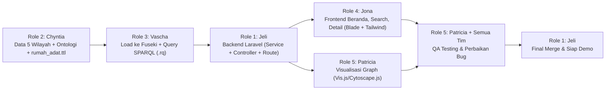

# Panduan Urutan Pengerjaan Project — Search Engine Rumah Adat Sumatera Utara

Dokumen ini dibuat sebagai **peta jalan langkah demi langkah** untuk **Kelompok 07** agar semua anggota tahu:
1. **Harus mulai dari mana** (dan apa yang sudah selesai di repo sekarang),
2. **Siapa mengerjakan apa** sesuai pembagian peran,
3. **Siapa menunggu siapa** vs **apa yang bisa dikerjakan barengan (paralel)** agar project cepat selesai tanpa bentrok kode.

---

## 1. Pembagian Peran Tim (Kelompok 07)

| Role | Nama | Fokus Utama | Output Utama |
| :--- | :--- | :--- | :--- |
| **Role 1** | **Jeli** | Project Lead & Backend Integration | Kerangka Laravel, Service penghubung Fuseki, Controller, code review & merge branch, kestabilan saat demo |
| **Role 2** | **Chyntia** | Ontology & RDF Dataset Engineer | Dokumen data bersih dari 5 wilayah, skema ontologi (Protégé/Turtle), file `rumah_adat.ttl` valid tanpa error |
| **Role 3** | **Vascha** | SPARQL Query & Semantic Logic Developer | Setup Apache Jena Fuseki, file query `.rq` (multi-hop, filter, detail, alasan keterkaitan / *match path*) |
| **Role 4** | **Jona** | UI/UX Designer & Frontend Utama | Tampilan responsif Beranda, Hasil Pencarian (+ badge alasan keterkaitan), & Halaman Detail (+ panel relasi semantik) |
| **Role 5** | **Patricia Putri** | Knowledge Graph Visualization & QA Tester | Halaman Visualisasi Knowledge Graph interaktif (`Vis.js` / `Cytoscape.js`) & hasil pengujian (QA Checklist) bebas bug |

---

## 2. Cara Kerja Aplikasi Kita (Versi Sederhana)

Bayangkan aplikasi kita seperti **restoran**:

1. **Chyntia (Bahan Makanan & Resep):** Menyiapkan bahan makanan yang bersih dan tersusun rapi dalam bentuk pengetahuan terhubung (`rumah_adat.ttl`) — misalnya rumah adat apa, sukunya apa, marganya apa, bahasanya apa, wilayahnya di mana, dan tradisinya apa.
2. **Vascha (Dapur & Racikan Pencarian):** Memasukkan bahan itu ke gudang khusus Semantic Web bernama **Apache Jena Fuseki**, lalu menyiapkan perintah pencarian cerdas (**query SPARQL `.rq`**) supaya kalau user mengetik kata yang *tidak langsung* menyebut nama rumah adat (misalnya ketik nama marga atau tradisi), sistem tetap bisa melacak sampai ke rumah adatnya dan menjelaskan *kenapa* itu muncul.
3. **Jeli (Pelayan / Penghubung):** Menyiapkan **Laravel** sebagai jembatan. Saat user mengetik pencarian di website, Laravel mengambil pertanyaan user, memanggil query dari Vascha ke server Fuseki, lalu membungkus hasilnya menjadi data rapi.
4. **Jona (Ruang Makan & Menu):** Membuat tampilan website yang cantik dan nyaman dipakai (**Beranda, Hasil Pencarian, Detail**) supaya data dari Jeli tampil menarik lengkap dengan kotak alasan keterkaitan.
5. **Patricia Putri (Peta Interaktif & Quality Control):** Membuat **peta garis hubungan (Knowledge Graph)** pakai `Vis.js` atau `Cytoscape.js` supaya user bisa melihat jaring-jaring budaya secara visual, sekaligus mengetes semua fitur untuk memastikan tidak ada link error atau pencarian yang meleset.

### Alur Kerja & Ketergantungan Antar Anggota



> **Kunci agar tidak saling menunggu terlalu lama:**  
> Jeli, Jona, dan Patricia **TIDAK PERLU diam menunggu** Chyntia dan Vascha selesai 100%. Mereka bisa langsung jalan dulu pakai **data contoh (dummy)**, lalu nanti tinggal disambungkan ke data Fuseki asli!

---

## 3. Posisi Kita Sekarang (Titik Start)

Sebelum melangkah ke urutan pengerjaan, ini kondisi asli di folder `tubes_rumah_adat/` saat ini:

- **Sudah selesai (`✅`):**
  - Struktur repo GitHub dan proyek **Laravel 13 + Tailwind CSS v4 + Vite** sudah dibuat (**Jeli**).
  - Layout utama (`resources/views/layouts/app.blade.php`) dan tampilan awal **Beranda** (`resources/views/pages/home.blade.php`) beserta *hero search bar* (`GET /search?q=...`) sudah jadi (**Jona**).
- **Belum ada (`⏳`):**
  - Kesepakatan struktur data & ontologi + file `rumah_adat.ttl` (**Chyntia**).
  - Apache Jena Fuseki + file query `.rq` (**Vascha**).
  - Route `/search`, `/detail`, `/graph`, Service Fuseki, dan Controller (**Jeli**).
  - Statistik dataset & *quick explore* wilayah di Beranda, Halaman Hasil Pencarian, & Halaman Detail (**Jona**).
  - Halaman Visualisasi Knowledge Graph & QA Testing (**Patricia**).

---

## 4. Urutan Pengerjaan Dari Awal Sampai Akhir

---

### FASE 0 — Persiapan Awal & Fondasi Proyek `[STATUS: SUDAH SELESAI ✅]`
*Pelaksana utama: **Jeli** & **Jona***

1. **Jeli** sudah menyiapkan repository GitHub dan proyek Laravel di `tubes_rumah_adat/`.
2. **Jona** sudah membuat tampilan pembuka Beranda (`resources/views/pages/home.blade.php`) dan kerangka layout (`resources/views/layouts/app.blade.php`).
3. **Catatan kecil sebelum lanjut ke Fase 1:**
   - Di repo masih ada file lokal `public/hot` yang menunjuk Vite port `5173`. Jika nanti menjalankan Laravel tanpa `npm run dev`, hapus `public/hot` agar tampilan memakai aset hasil build (`public/build`).
   - Pastikan teman-teman yang menarik kode baru selalu menjalankan `composer install` dan `npm install` jika ada dependensi baru.

---

### FASE 1 — Rapat Singkat "Kontrak Data" (WAJIB SEBELUM MULAI NGODING BERAT)
*Pelaksana: **Semua Anggota (15–30 menit diskusi bareng)***

Sebelum Chyntia membuat ontologi dan Jeli/Jona/Patricia membuat kode, sepakati 3 hal ini agar nanti tidak perlu bongkar ulang:

1. **Apa saja 5 wilayah yang masuk dalam dataset?**  
   *(Contoh: Wilayah Toba/Tapanuli Utara, Karo, Simalungun, Mandailing/Angkola, Nias — tentukan daftar pastinya agar cocok antara data Chyntia dan tombol "Quick Explore Wilayah" di Beranda Jona).*
2. **Apa saja entitas (Class) dan relasi (Property) yang dipakai?**  
   Contoh kesepakatan paling mudah:
   - **Class:** `RumahAdat`, `Suku`, `Wilayah`, `Bahasa`, `Marga`, `Tradisi`, `Arsitektur` (atau `Material` / `Filosofi`).
   - **Object Property (penghubung antar entitas):** `berasalDariSuku`, `beradaDiWilayah`, `menggunakanBahasa`, `terkaitMarga`, `memilikiTradisi`, `memilikiArsitektur`.
   - **Data Property (info teks/angka/link):** `namaRumah`, `deskripsi`, `filosofi`, `urlFoto`, `urlReferensi`.
3. **Format data yang akan ditampilkan di web:**  
   Setiap kartu rumah adat minimal butuh: `id/slug`, `nama`, `wilayah`, `suku`, `ringkasan`, `urlFoto`, dan **`alasanKeterkaitan` (match path)**.

> **Hasil Fase 1:** Daftar 5 wilayah dan daftar nama Class + Property disepakati bersama (tulis di catatan grup / file markdown kecil agar tidak lupa).

---

### FASE 2 — Mengolah Data Bersih & Membangun Ontologi (`rumah_adat.ttl`)
*Pelaksana utama: **Chyntia** | Yang lain jalan paralel (lihat kotak di bawah)*

#### Yang Dikerjakan Chyntia (Urutan Langkah):
1. **Kumpulkan & Bersihkan Data 5 Wilayah (pakai Spreadsheet/Excel/Google Sheets dulu):**
   - Kumpulkan seluruh informasi rumah adat dari 5 wilayah: nama rumah adat, suku, wilayah/kabupaten, bahasa daerah, marga terkait, tradisi/upacara, ciri arsitektur/material, filosofi, **link foto**, dan **link sumber referensi**.
   - **Seragamkan penulisan!** Ini sangat penting di Web Semantik:
     - Jangan sampai di satu baris ditulis `"Batak Toba"`, di baris lain `"batak toba"`, atau `"Toba"`.
     - Pastikan tiap link foto dan link referensi benar-benar bisa dibuka.
2. **Rancang Skema Ontologi di Protégé / Turtle:**
   - Buat *Class* dan *Property* sesuai hasil kesepakatan Fase 1.
   - Tentukan *Domain* dan *Range* tiap relasi (misal: `berasalDariSuku` menghubungkan `RumahAdat` → `Suku`).
   - Jika memakai hierarki kelas (`rdfs:subClassOf`), misalnya `RumahPanggung` subClass dari `RumahAdat`, pastikan konsisten.
3. **Konversi Data Menjadi File `rumah_adat.ttl`:**
   - Ubah seluruh data dari spreadsheet menjadi *triple* RDF berformat Turtle (`.ttl`).
   - Tips mudah: gunakan template Turtle yang seragam atau ekspor dari Protégé / skrip konverter Python agar tidak salah tanda baca.
4. **Validasi Sintaks Turtle:**
   - Pastikan `rumah_adat.ttl` **bebas syntax error** (bisa dicek dengan membuka file di Protégé, atau menjalankan skrip `rdflib` seperti `g.parse("rumah_adat.ttl", format="turtle")`, atau langsung tes upload ke Fuseki).
   - Simpan hasilnya di repo, misalnya pada folder `tubes_rumah_adat/database/ontology/rumah_adat.ttl`.

#### Yang Bisa Dikerjakan Teman Lain di Saat Bersamaan (Kerja Paralel!):
Supaya proyek tidak macet menunggu Chyntia selesai:
- **Vascha:** Instal **Apache Jena Fuseki** di komputer, coba jalankan servernya (`http://localhost:3030`), buat dataset percobaan, dan latih membuat draf query SPARQL *multi-hop* memakai 2–3 contoh data dummy.
- **Jeli:** Siapkan struktur route di `routes/web.php` (`/search`, `/rumah-adat/{slug}`, `/graph`, `/api/graph`), buat `SearchController` & `FusekiService` dengan data dummy sementara (array PHP) sesuai format kesepakatan Fase 1.
- **Jona:** Lanjutkan desain UI Halaman Hasil Pencarian (`search.blade.php`) lengkap dengan **badge alasan keterkaitan**, Halaman Detail (`detail.blade.php`) lengkap dengan **panel tautan relasi semantik**, dan tambahkan bagian **Statistik Dataset** serta **Quick Explore 5 Wilayah** di `home.blade.php` menggunakan data dummy dari controller Jeli.
- **Patricia Putri:** Siapkan halaman `/graph` dan mulai coba library **Vis.js** atau **Cytoscape.js** pakai data node & edge contoh kecil supaya gambar graf sudah tampil cantik lebih awal, sambil menyusun daftar skenario QA.

> **Selesai jika:** File `rumah_adat.ttl` sudah valid tanpa error dan sudah di-push ke branch Chyntia lalu di-review/merge Jeli.

---

### FASE 3 — Setup Apache Jena Fuseki & Membuat Query SPARQL (`.rq`)
*Pelaksana utama: **Vascha** (memakai `rumah_adat.ttl` dari **Chyntia**)*

#### Yang Dikerjakan Vascha (Urutan Langkah):
1. **Load Dataset ke Apache Jena Fuseki:**
   - Buat dataset baru di Fuseki (misalnya bernama `rumah_adat`).
   - Upload file `rumah_adat.ttl` milik Chyntia ke dataset tersebut dan pastikan jumlah *triples* terbaca dengan benar.
2. **Tulis & Uji Query SPARQL Satu Per Satu di Fuseki UI (`http://localhost:3030`):**
   Simpan setiap query yang sudah berhasil menjadi file `.rq` di folder `tubes_rumah_adat/resources/sparql/` (atau folder khusus query):
   - **`01_statistik.rq`:** Menghitung total rumah adat, jumlah suku, dan jumlah wilayah (untuk kotak statistik di Beranda Jona).
   - **`02_search_multihop.rq`:** Pencarian kata kunci bebas (`?keyword`) yang bisa menelusuri **lintas hubungan (multi-hop)** — tidak hanya mencocokkan nama rumah adat, tapi juga bisa menemukan rumah adat ketika user mengetik nama **suku, bahasa, marga, wilayah, atau tradisi**.
   - **`03_match_path.rq` (atau bagian dari query search):** Mengembalikan **alasan keterkaitan**, contoh:
     - User mencari: `"Harahap"`
     - Hasil ketemu: **Bagas Godang**
     - Alasan keterkaitan yang dikembalikan query: `Cocok via Marga: Harahap -> Suku: Angkola -> Rumah Adat: Bagas Godang`
   - **`04_filter.rq`:** Query pencarian dengan filter kategori (misal filter berdasarkan wilayah, suku, atau kategori arsitektur).
   - **`05_detail.rq`:** Mengambil seluruh detail satu rumah adat berdasarkan URI/slug (deskripsi, filosofi, foto, referensi, serta semua entitas yang terhubung dengannya).
   - **`06_knowledge_graph.rq`:** Mengambil node (entitas) dan edge (relasi) untuk kebutuhan visualisasi graf interaktif Patricia (baik graf keseluruhan maupun graf untuk 1 rumah adat tertentu).
3. **Dokumentasikan Endpoint & Parameter Query:**
   - Catat variabel apa yang perlu diisi oleh Laravel (misalnya placeholder `{{KEYWORD}}`, `{{WILAYAH}}`, `{{URI}}`) agar Jeli mudah memasukkannya ke backend.

> **Selesai jika:** Semua file `.rq` sudah diuji langsung di Apache Jena Fuseki, hasilnya akurat, tidak mengembalikan duplikasi baris yang mengganggu, dan sudah di-push ke branch Vascha.

---

### FASE 4 — Menghubungkan Laravel dengan Fuseki (Integrasi Backend)
*Pelaksana utama: **Jeli** (menggabungkan kerja **Chyntia** & **Vascha** ke Laravel)*

#### Yang Dikerjakan Jeli (Urutan Langkah):
1. **Konfigurasi Koneksi Triplestore:**
   - Tambahkan variabel `FUSEKI_URL=http://localhost:3030` dan `FUSEKI_DATASET=rumah_adat` di `.env` / `.env.example`, lalu daftarkan di `config/services.php`.
2. **Bangun `SparqlService` / `RumahAdatSearchService`:**
   - Buat class di `app/Services/` untuk:
     - Membaca file `.rq` dari Vascha.
     - Menyisipkan kata kunci/filter user secara aman (**sanitasi input** agar tanda kutip atau karakter aneh tidak merusak sintaks SPARQL).
     - Mengirim request ke endpoint SPARQL Fuseki menggunakan Laravel `Http::asForm()->post(...)` dengan format `Accept: application/sparql-results+json`.
     - Mengubah JSON mentah dari Fuseki menjadi array/objek PHP yang bersih dan mudah dibaca oleh Blade & JSON API.
     - Menangani error dengan ramah (misal jika server Fuseki lupa dinyalakan, tampilkan pesan yang jelas dan tidak *crash*).
3. **Pasang ke Controller & Route:**
   - `HomeController` → mengambil data statistik dataset & daftar 5 wilayah untuk `home.blade.php`.
   - `SearchController` → melayani `/search` (input `q`, filter kategori, hasil + **alasan keterkaitan / match path**).
   - `DetailController` (atau method `show` di `RumahAdatController`) → melayani `/rumah-adat/{slug}` untuk halaman detail & relasi semantik.
   - `GraphController` → melayani halaman `/graph` dan endpoint JSON `/api/graph` untuk visualisasi Patricia.
4. **Code Review & Merge Awal:**
   - Gabungkan branch Chyntia (`rumah_adat.ttl`), Vascha (`*.rq`), dan Jona (tampilan Blade) agar tersambung di satu project utuh.

> **Selesai jika:** Saat membuka `/search?q=...` di browser, Laravel benar-benar mengambil hasil dari Fuseki (bukan dummy lagi).

---

### FASE 5 — Penyempurnaan UI/UX dengan Data Asli
*Pelaksana utama: **Jona** (dibantu **Jeli** jika ada penyesuaian data Controller)*

#### Yang Dikerjakan Jona (Urutan Langkah):
1. **Lengkapi Halaman Beranda (`resources/views/pages/home.blade.php`):**
   - Pastikan **hero search bar** tetap rapi dan jelas.
   - Tambahkan bagian **Statistik Dataset** (misal: Total Rumah Adat, Jumlah Suku, Jumlah Wilayah) yang mengambil angka asli dari backend.
   - Ubah/lengkapi bagian eksplorasi cepat menjadi **Quick Explore 5 Wilayah** (klik wilayah langsung mengarah ke hasil pencarian wilayah tersebut).
2. **Finalisasi Halaman Hasil Pencarian (`resources/views/pages/search.blade.php`):**
   - Tampilkan ulang kotak pencarian berisi kata kunci yang dicari user.
   - Tampilkan **filter kategori** (wilayah, suku, dll.).
   - Pada setiap kartu rumah adat, tampilkan foto, nama, asal wilayah/suku, ringkasan, dan **Badge Alasan Keterkaitan** (contoh badge: *"Terhubung lewat Tradisi: Mangokkal Holi"* atau *"Terhubung lewat Marga: Harahap"*).
   - Siapkan tampilan **hasil kosong (empty state)** jika kata kunci tidak ditemukan (beserta saran pencarian lain).
3. **Finalisasi Halaman Detail (`resources/views/pages/detail.blade.php`):**
   - Tampilkan informasi lengkap rumah adat, foto, filosofi, arsitektur, dan sumber referensi.
   - Buat **Panel Tautan Relasi Semantik** yang interaktif: misalnya Suku, Wilayah, Bahasa, Marga, dan Tradisi ditampilkan sebagai tautan/chip yang bila diklik akan langsung mencari atau membuka keterkaitan lainnya, serta tombol *"Lihat di Knowledge Graph"*.
4. **Cek Responsivitas:**
   - Pastikan tampilan tetap rapi di layar **Laptop/Desktop** maupun **HP (Mobile)**.

> **Selesai jika:** Seluruh alur Beranda → Hasil Pencarian → Detail berjalan mulus pakai data asli Fuseki, responsif, dan sesuai tema *Modern Cultural Heritage*.

---

### FASE 6 — Visualisasi Knowledge Graph Interaktif
*Pelaksana utama: **Patricia Putri** (menggunakan data graf dari **Vascha** & endpoint **Jeli**)*

#### Yang Dikerjakan Patricia Putri (Urutan Langkah):
1. **Siapkan Halaman & Library Graf:**
   - Buat view khusus halaman Knowledge Graph (misal `resources/views/pages/graph.blade.php`) dan pasang tautannya di Navbar (`app.blade.php`) maupun di halaman Detail.
   - Pasang library **Vis.js (`vis-network`)** atau **Cytoscape.js** (bisa lewat Vite/npm atau CDN yang rapi).
2. **Sambungkan ke Data Dinamis dari Laravel (`/api/graph`):**
   - Ambil data *nodes* (entitas) dan *edges* (hubungan) dari backend Jeli.
   - Bedakan warna/ikon berdasarkan jenis entitas agar mudah dibaca user (misal: Rumah Adat warna merah heritage, Suku warna oranye/peach, Wilayah warna biru dongker, Tradisi/Marga warna lain).
   - Tampilkan label relasi pada garis penghubungnya (misal: `berasalDariSuku`, `terkaitMarga`, `beradaDiWilayah`).
3. **Tambahkan Interaktivitas:**
   - User bisa klik node untuk melihat info singkat atau langsung melompat ke halaman detail rumah adat tersebut.
   - Tambahkan fitur zoom, geser (*pan*), atau filter fokus (misal menampilkan graf khusus 1 rumah adat atau seluruh dataset).

> **Selesai jika:** Halaman Knowledge Graph bisa menampilkan node & garis hubungan secara dinamis dari data asli Fuseki, bisa diklik/zoom, dan tidak error di console browser.

---

### FASE 7 — Pengujian Menyeluruh (QA), Perbaikan Bug, & Persiapan Demo
*Pelaksana utama: **Patricia Putri** (QA) + **Jeli** (Final Merge) + **Semua Anggota** (Perbaikan)*

#### Checklist Pengujian oleh Patricia Putri:
1. **Uji Skenario Pencarian Tidak Langsung (Multi-Hop) — Minimal 5–10 Skenario:**
   - Cari pakai nama **Suku** → Apakah rumah adat yang tepat muncul? Apakah badge alasannya benar?
   - Cari pakai nama **Marga** → Apakah rumah adat terkait muncul?
   - Cari pakai nama **Bahasa** → Apakah rumah adat terkait muncul?
   - Cari pakai nama **Wilayah / Kabupaten** → Apakah rumah adat di wilayah itu muncul?
   - Cari pakai nama **Tradisi** → Apakah rumah adat terkait muncul?
   - Uji huruf besar/kecil (*case-insensitive*), spasi berlebih, dan kata kunci yang tidak ada (*empty state*).
2. **Uji Semua Fitur UI & Link:**
   - Klik semua tombol **Quick Explore Wilayah** di Beranda.
   - Coba semua kombinasi **Filter Kategori** di halaman pencarian.
   - Klik semua **Tautan Relasi Semantik** di halaman detail.
   - Pastikan **semua foto rumah adat** muncul (tidak ada gambar pecah) dan **semua link referensi** bisa dibuka.
   - Uji tampilan di ukuran layar HP dan Desktop.
3. **Catat & Laporkan Bug:**
   - Buat daftar temuan (misal file `QA_CHECKLIST.md` atau spreadsheet): tulis skenario, hasil yang diharapkan, hasil aktual, dan status (`PASS` / `FAIL`).
   - Jika ada data salah/kurang → lapor ke **Chyntia**.
   - Jika query tidak menemukan hasil / alasan keterkaitan keliru → lapor ke **Vascha**.
   - Jika error 500 / data kosong di controller → lapor ke **Jeli**.
   - Jika tampilan berantakan / kepotong → lapor ke **Jona**.
   - Jika node graf tumpang tindih / error JS → perbaiki di kode **Patricia**.

#### Finalisasi Oleh Jeli (Menjelang Demo):
1. Review dan merge semua perbaikan terakhir ke branch `main`.
2. Jalankan `npm run build` agar aset CSS/JS terbaru terkompilasi rapi (dan hapus `public/hot` bila tidak memakai Vite dev server).
3. Latih alur demo dari awal sampai akhir bersama tim: pastikan **Apache Jena Fuseki** menyala, dataset `rumah_adat.ttl` ter-load, dan server Laravel berjalan stabil tanpa error.

---

## 5. Ringkasan Cepat: "Hari Ini Saya Harus Ngapain?"

Gunakan tabel ini untuk langsung cek tugas pertama masing-masing **mulai hari ini**:

| Anggota | Tugas Pertama (Segera Mulai!) | Tugas Menengah (Setelah Data Siap) | Tugas Akhir (Menjelang Demo) |
| :--- | :--- | :--- | :--- |
| **Jeli** | Siapkan config Fuseki di Laravel + buat route & controller dengan data dummy | Integrasikan file `.rq` Vascha lewat `SparqlService` & merge branch teman | Final code review, merge ke `main`, build aset, jaga kestabilan demo |
| **Chyntia** | Kumpulkan & rapikan data 5 wilayah + rancang ontologi (Class & Property) | Konversi ke `rumah_adat.ttl` dan validasi sintaks sampai bebas error | Bantu perbaiki data/link foto jika ditemukan bug saat QA Patricia |
| **Vascha** | Instal & jalankan Apache Jena Fuseki + siapkan kerangka query multi-hop | Load `rumah_adat.ttl` ke Fuseki + buat & uji semua file query `.rq` | Bantu perbaiki query SPARQL jika hasil pencarian / match path kurang akurat saat QA |
| **Jona** | Tambah section Statistik & Quick Explore 5 Wilayah + buat layout Search & Detail (pakai dummy) | Sambungkan view Beranda, Search (+ badge alasan), & Detail (+ relasi) ke data asli Jeli | Perbaiki bug tampilan/responsif dari hasil temuan QA Patricia |
| **Patricia Putri** | Siapkan halaman `/graph` & tes `Vis.js` / `Cytoscape.js` pakai contoh graf kecil + buat skenario QA | Sambungkan Visualisasi Knowledge Graph ke data dinamis `/api/graph` dari Jeli | Jalankan QA Checklist penuh (uji multi-hop, foto, referensi) sampai bebas bug |

---

## 6. Aturan Praktis GitHub Kelompok (Supaya Tidak Saling Timpa Kode)

1. **Jangan ngoding langsung di branch `main`.** Selalu buat branch per fitur, misalnya:
   - `feat/ontology-dataset` (Chyntia)
   - `feat/sparql-queries` (Vascha)
   - `feat/backend-fuseki` (Jeli)
   - `feat/frontend-pages` (Jona)
   - `feat/knowledge-graph` (Patricia)
2. **Sebelum mulai kerja setiap hari**, biasakan tarik update terbaru dari `main`:
   ```bash
   git checkout main
   git pull origin main
   ```
3. **Setiap selesai 1 bagian kerja yang sudah jalan**, buat *Pull Request (PR)* ke `main` dan minta **Jeli** melakukan *review & merge* agar kode teman-teman yang lain selalu sinkron.
